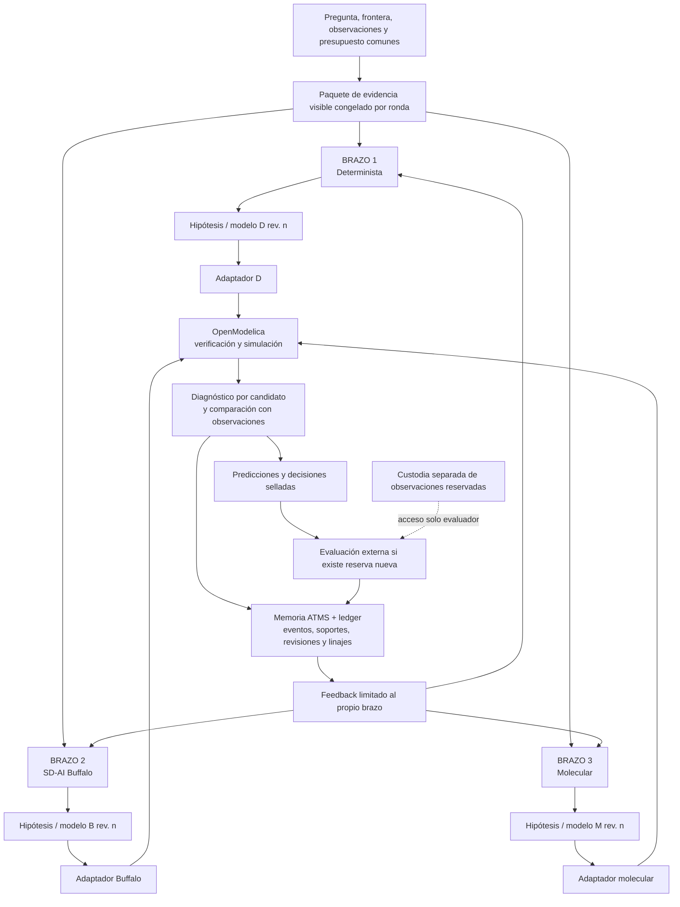

# IGC · Arena de Dinámica de Sistemas con tres brazos independientes, cuarto Clef posterior y memoria ATMS

**Plan rector de implementación — versión 1.3 | 25 de octubre de 2026**  
**Estado:** decisión arquitectónica del investigador; plan de trabajo, **no** certificación de integración ni resultado científico.  
**Sustituye en las decisiones incompatibles:** las versiones 1.1 y 1.2. Ambas permanecen como antecedentes históricos; la 1.3 conserva la definición de V0 con tres técnicas independientes y añade el orden explícito **3 → 4 (Clef)** y la consolidación no destructiva de `main`.  
**Repositorio canónico:** [`yudocyudoc/IGC`](https://github.com/yudocyudoc/IGC). **Fuente histórica y de reutilización:** [`yudocyudoc/short`](https://github.com/yudocyudoc/short). **Referencia metodológica independiente:** [`UB-IAD/sd-ai`](https://github.com/UB-IAD/sd-ai).  
**Ejecución inmediata:** GitHub/GitHub Actions; Cloudflare como proveedor de inferencia; OpenModelica como simulador común. No introducir un circuito de callbacks Cloudflare ↔ GitHub ni hacer de una interfaz gráfica un prerrequisito.

> **Mandato del investigador.** Primero tres técnicas **independientes** producen hipótesis sobre el mismo sistema: **(1) determinista, (2) SD-AI de la Universidad de Buffalo y (3) molecular**. Cada una lleva sus modelos a **OpenModelica** para comprobar consecuencias y compararlas con observaciones. Los resultados pueden devolverse al **mismo brazo** para otra iteración. **ATMS es la memoria versionada de supuestos, justificaciones, contradicciones, revisiones y dependencias a lo largo de las iteraciones**; no se reduce a evaluar AND/OR ni sirve para mezclar los tres métodos. Cuando V0 sea funcional, se añadirá **Clef como cuarto brazo experimental**, conservando por separado los resultados anteriores para medir qué cambia. No se activará Clef durante V0, ni se confundirá una tarea de clasificación/juicio con generación autónoma de topologías no demostrada. Más adelante el laboratorio investigará políticas e intervenciones: **no diseñar esa etapa ahora**.

---

## 0. Objetivo inmediato y frontera

Construir una **Arena experimental reproducible de Dinámica de Sistemas** capaz de responder:

1. ¿Qué mecanismo propone **cada técnica por separado** ante la misma evidencia y pregunta?
2. ¿Puede formalizarse su propuesta **sin cambiarle silenciosamente la estructura**?
3. ¿Qué comportamiento produce al ejecutarla en OpenModelica y qué observaciones respalda, contradice o deja sin explicar?
4. Tras recibir ese diagnóstico, ¿puede cada técnica **revisar su propia hipótesis** y producir una versión mejor, diferente o una abstención justificada?
5. ¿Qué recuerda ATMS de cada paso y qué dependencias/justificaciones cambian al llegar nueva evidencia?

La Arena **no** busca, en esta fase, combinar los brazos ni adelantar Clef para producir un solo modelo, optimizar prompts de manera indefinida, crear un catálogo universal de moléculas ni recomendar cambios organizacionales reales. La investigación de políticas, prioridades, recopilación de datos y PoC se reconoce como **proyección futura** (§11).

**Éxito inicial** significa cerrar al menos un ciclo trazable de **tres propuestas independientes → formalización → OpenModelica → diagnóstico → revisión por brazo**, incluso si alguno falla o no puede generar un modelo válido. Un brazo no está obligado a acertar, y un resultado `UNKNOWN/NOT_IDENTIFIABLE` puede ser correcto.

## 1. Cambios de decisión respecto de v1.1/v1.2

| Tema | Lectura anterior v1.1 | Decisión vigente v1.2 |
|---|---|---|
| Brazo D | Compositor **determinista + moléculas** como una sola vía | **Brazo 1 determinista autónomo**, sin depender del catálogo ni compositor molecular para generar sus hipótesis |
| Brazo S | SD-AI/LLM con posibilidad de entrar al mismo compositor | **Brazo 2 Buffalo**, con sus procedimientos cualitativos/cuantitativos y su representación propia; **sin moléculas** |
| Brazo molecular | Subsistema dentro de D/ATMS | **Brazo 3 molecular autónomo**, con su catálogo, contratos, linter y compositor |
| P / Clef / Clairic | Tercera vía de producción D/S/P | **Clef será cuarto brazo en una ampliación posterior, no ejecutado en V0**. Clairic queda como antecedente de experimentos numéricos y recurso separado. Su rol exacto y tareas comparables se fijarán tras el resultado de los tres brazos. |
| OpenModelica | Validaba especialmente la cadena molecular | **Destino común para los tres brazos**, con adaptadores propios y verificación de fidelidad de cada traducción |
| ATMS | Motor de justificaciones con uso destacado en selección/admisión | **Memoria epistemológica y de dependencias durante todas las iteraciones**, transversal al laboratorio; nunca sustituye al ledger ni a OpenModelica |
| Aprendizaje | Evaluación/revisión orientada a una Arena integrada | **Cada brazo recibe el diagnóstico de sus propios modelos**, revisa sin ver propuestas de los rivales y mantiene su linaje |
| Fases futuras | P1–P9 y transferencia desarrolladas en detalle | **Solo se enuncian como horizontes**; la implementación detallada se concentra en la Arena de tres brazos y su ampliación posterior a Clef se menciona sin implementarla ahora |

**El documento v1.1 ya contenía** requisitos valiosos de ledger bitemporal, procedencia, soporte lógico distinto de verdad, aislamiento de reserva, predicciones selladas, G1/G2/G3 y retractación ATMS. Se conservan donde sean compatibles. **No** reutilizar literalmente sus diagramas, contratos `D/S/P`, instrucciones a coders o gates que fusionan D con moléculas.

## 2. Arquitectura de la Arena

**Lectura obligatoria del diagrama:** las flechas desde `Feedback` representan **tres mensajes independientes y filtrados**, no una memoria de propuestas compartida entre productores. OpenModelica y el evaluador no modifican por sí mismos los modelos; producen informes. ATMS registra y explica revisiones pero **no diseña los mecanismos por los brazos**.

### 2.1 Brazo 1 — Determinista (`D`)

**Método:** reglas explícitas, restricciones, búsqueda/derivación/enumeración declarada de estructuras y parámetros permitidos. Sus resultados dependen del algoritmo y de la evidencia, **no** de inferencia LLM ni del compositor de moléculas. Puede producir varias hipótesis o un conjunto incompleto con causa documentada.

**Salida nativa:** estructuras y ecuaciones propuestas por su propio procedimiento, más explicación reproducible de las reglas que las generaron. **Límite:** si solo explora una familia o un inventario cerrado, informarlo; no confundir la cobertura de búsqueda con el universo posible.

### 2.2 Brazo 2 — SD-AI de la Universidad de Buffalo (`B`)

**Método:** adoptar/reproducir las técnicas de la investigación de [SD-AI](https://github.com/UB-IAD/sd-ai), especialmente sus enfoques cualitativo (relaciones causales/CLD) y cuantitativo (stocks, flows, ecuaciones/modelos estructurados), y su revisión de un `currentModel` cuando corresponda. Es **una línea metodológica propia**, no un conjunto de instrucciones añadidas al brazo molecular.

**Salida nativa:** las representaciones de SD-AI —por ejemplo relaciones causales y modelo cuantitativo estructurado— con versiones, prompts, motor/LLM y transformaciones rastreables. Una CLD por sí sola **no es** una simulación cuantitativa; si falta información para formalizar, devolver un bloqueo o pregunta, sin inventar ecuaciones.

**Independencia:** no usar moléculas, catálogo molecular ni propuestas D/M para construir hipótesis. El adaptador Buffalo→Modelica transforma la salida del brazo con un contrato visible y auditado; no se le permite añadir mecanismos sustantivos para «hacerlo compilar». Documentar compatibilidades y permisos/licencia antes de reutilizar código upstream.

### 2.3 Brazo 3 — Molecular (`M`)

**Método:** propuesta/selección/composición de moléculas dinámicas con sus catálogos, contratos, unidades, puertos, roles y restricciones. Reutiliza la investigación FM-A/FM-B ya disponible en las ramas de IGC y los antecedentes de Short **previa auditoría**.

**Salida nativa:** configuración molecular, IR tipado, topología, parámetros o incógnitas, resultado del linter y Modelica generado mediante su compositor.

**Límite:** puede no existir una molécula admisible para representar un mecanismo. `NO_MATCHING_MOLECULE`, `UNRESOLVED`, `INVALID_STRUCTURE` o `PARTIAL` son resultados válidos; no reemplazar el mecanismo por otro de nombre parecido ni atribuir ese bloqueo a los otros brazos.

### 2.4 Brazo 4 posterior — Clef (`C`, **INACTIVE/NOT_IMPLEMENTED en V0**)

**Decisión de secuencia:** construir, ejecutar y comparar primero D/B/M como tres generadores autónomos. **Después**, sin sustituir sus recibos ni redefinir retrospectivamente los criterios, estudiar qué cambia cuando se incorpora Clef en un cuarto brazo. Los resultados de `short` (EPI-03, EPI-04, EPI-05 y EPI-06) deben inventariarse distinguiendo **diseño congelado, inferencia realmente ejecutada, observaciones y errores**.

**Precaución:** Clef es un modelo de juicio/elección estructurada. No atribuirle generación cuantitativa de stocks, flujos o Modelica si no la demuestra. La futura ampliación deberá establecer **qué hipótesis o juicios produce nativamente**, cómo se contrasta lo comparable y cómo se reporta `NOT_APPLICABLE` cuando corresponda. Sin mezclar respuestas ni mejorar los tres brazos durante la comparación original. **No diseñar ni ejecutar ese cuarto brazo en V0.**

### 2.4 Independencia: lo común y lo exclusivo

**Común y comparable:** pregunta, comportamiento de referencia, variables observables, unidades, instrumentos y error conocido, evidencia primaria autorizada, cortes temporales, horizonte, perturbaciones evaluativas, reglas de simulación/evaluación y límites presupuestarios pertinentes.

**Propio de cada brazo:** técnica, material metodológico, código generador, formatos nativos, catálogo privado del método, historial de sus propuestas y sus revisiones. Ningún brazo ve los razonamientos, resultados privados o estructuras de otro mientras está generando o revisando en una comparación independiente.

Una vista común **no tiene por qué imponer un modelo estructural común**. Si la metodología de Buffalo necesita una descripción narrativa y D requiere variables normalizadas, ambos derivan sus entradas del **mismo contenido fuente autorizado**; se conserva el registro de qué transformación recibió cada uno.

## 3. Interfaz común de comparación: converger en la prueba, no en el método

El único contrato compartido de **evaluación** acepta entregas heterogéneas. No hay un formato conceptual obligatorio de moléculas ni un generador Modelica único impuesto a todos.

**Sobre por entrega (`ArmSubmission`, contrato propuesto):**

- `investigation_id`, `round_id`, `iteration`, `arm_id ∈ {D,B,M}` en V0; `C` queda reservado para una versión posterior y es rechazado expresamente en V0, `source_snapshot_hash`;
- `native_artifact_ref/hash`, `native_method_version`, `generation_trace_ref`;
- `hypothesis_id`, `revision_id`, `parent_revision_id` (si existe), `assumption_ids`, `evidence_refs`;
- `modelica_artifact_ref/hash` **solo si existe**, `translation_report`, `missing_parameters`, `unsupported_mechanisms`;
- `status` (`PROPOSED`, `PARTIAL`, `ABSTAINED`, `BLOCKED`, `EXECUTABLE`, etc.), costos medidos y explicación.

**Regla de fidelidad:** cada brazo debe poder decir «eso no era lo que propuse». Si el adaptador añadió un stock, cambió una ecuación, modificó unidades, fijó un parámetro ausente o sustituyó un delay por otro mecanismo, la modificación debe quedar explícita y requerir aceptación/regeneración del mismo brazo. Nunca usar una molécula como traductor universal de Buffalo y D.

**Regla de igualdad:** mismas pruebas y criterios de adjudicación en la medida aplicable, no falsa igualdad de internals. Si un brazo no consigue formalizarse, cuenta como bloqueo/abstención; no recibir automáticamente un candidato de otro brazo para lograr un `PASS`.

## 4. OpenModelica: árbitro común, con límites epistemológicos

La Arena evalúa cada candidato **por separado** y conserva sus trazas. Los tres brazos comparten un contrato observable; ninguno obtiene puntos por producir más estructuras sin mejor justificación.

| Nivel | Verificación | Conclusión permitida |
|---|---|---|
| **G0 — Fidelidad** | Artefacto Modelica corresponde a la hipótesis nativa; transformación y parámetros trazables | `FAITHFUL`, `TRANSLATION_CHANGED_MECHANISM`, `INCOMPLETE` |
| **G1 — Formal** | Unidades, dimensiones, ecuaciones, balances, conectividad, iniciales, límites físicos definidos | `FORMALLY_ADMISSIBLE` o error localizado |
| **G2 — Ejecutable** | Compilación y simulación OpenModelica, solver, límites e invariantes | `SIMULATES` / error técnico; **no** verdad causal |
| **G3 — Adecuación** | Comparación con **datos de construcción** y su error; posible calibración solo en los límites autorizados | Compatible, inadecuado, insuficiente o no identificable **condicionalmente** |
| **Comparación** | Predicciones de rivales, ensayos/perturbaciones comunes, costo, incertidumbre | Distinguibles o `NON_DISCRIMINATING` bajo la prueba |
| **Evaluación reservada** | Tras sellar predicciones, evaluación separada sobre datos todavía ocultos | Poder predictivo fuera de muestra; no demuestra causalidad universal |

**Diferencias que se deben preservar:** error de traducción ≠ fallo de hipótesis; fallo de solver ≠ observación adversa; parámetro mal calibrado ≠ estructura imposible; reproducción histórica ≠ identificación causal. Una simulación puede **falsar una consecuencia predicha dentro del modelo**, pero no verificar directamente que el mecanismo describa el mundo real. La confrontación con mediciones es indispensable.

Se admite que dos o tres brazos lleguen a la misma estructura, a estructuras distintas, o a ninguna. ATMS registra esa convergencia/controversia **sin votar ni combinar propuestas**.

## 5. ATMS es memoria de investigación a través de iteraciones

### 5.1 Responsabilidad de ATMS

ATMS **no es un booleano de admisión ni una función AND/OR sobre modelos**. Es el mecanismo de mantenimiento de soportes y dependencias de un proceso de investigación que cambia con evidencia y resultados:

- qué observación, fuente, hipótesis, supuesto y formulación sostuvo una decisión;
- bajo qué **entornos mínimos de supuestos** una proposición o modelo era defendible;
- qué relaciones son `supports`, `challenges`, `undercuts`, `derived_from` o solo `relevant`;
- qué versiones y predicciones dependían de una premisa o fuente ya revisada;
- qué sigue siendo viable si una justificación falla y qué alternativas se restablecen al corregirla;
- qué sabía cada brazo **en cada corte**, qué afirmó, qué simuló, qué diagnóstico recibió y qué cambió después;
- por qué una decisión es distinta en la revisión `n+1` respecto a `n`, sin reescribir la historia.

**Precisión arquitectónica:** el **ledger append-only y los artefactos identificados por hash** conservan eventos y datos originales (incluidas series y resultados del solver). La **proyección ATMS versionada** mantiene sus justificaciones, premisas, conflictos, etiquetas mínimas, dependencias y explicaciones. Así ATMS funciona como memoria **razonada**, no como almacenamiento indiscriminado de CSV, ni como una base vectorial ni como un simulador.

### 5.2 Eventos mínimos por iteración

| Evento | Qué conserva la memoria |
|---|---|
| `EVIDENCE_REGISTERED` | Fuente, observación, instrumento, error, tiempo del evento y tiempo de registro |
| `HYPOTHESIS_PROPOSED` | Brazo, revisión, relación con hipótesis anteriores, supuestos y argumentos |
| `MODEL_FORMALIZED` | Transformación, correspondencia nativo→Modelica, ecuaciones, parámetros, hashes |
| `SIMULATION_COMPLETED/FAILED` | Run, trazas inmutables, G0–G3, fallo localizado y restricciones |
| `PREDICTION_LOCKED` | Pronósticos/versiones sellados antes de abrir datos reservados |
| `EVALUATION_RECORDED` | Comparación y alcance; reserva consumida si fue abierta |
| `FEEDBACK_DELIVERED` | Mensaje exacto, destinatario y evidencia autorizada en esa iteración |
| `HYPOTHESIS_REVISED/RETRACTED` | Qué cambió, cuál supuesto se retiró, qué justificaciones sobreviven |

**Ejemplo conceptual:** en `B:r1`, Buffalo propone que una subida de pedidos aumenta inmediatamente entregas. En `B:r1:G2` el modelo ejecuta, pero la tasa queda limitada por capacidad. ATMS preserva la afirmación, el modelo y la contradicción **condicional al modelo**. En `B:r2`, Buffalo propone un stock de pedidos pendientes y una tasa limitada. ATMS vincula `r2` con `r1` y explica la revisión; **no borra** la propuesta original ni la registra automáticamente como falsada por la realidad.

### 5.3 Límites y separación de memoria

1. **Historia intacta:** append-only, `valid_time`/`recorded_at`, `as_known_at`, fuente y revisión versionadas.
2. **Soportes alternativos:** retractación/restitución selectivas y `nogoods` con contexto, fecha y fundamento; no producir contradicciones globales espurias.
3. **Sin contaminación entre brazos:** la memoria institucional puede conocer los resultados de todos **para auditar/comparar**, pero una consulta usada como entrada de construcción/revisión solo devuelve **evidencia pública autorizada y el historial propio del brazo**. Las propuestas de los otros siguen excluidas incluso en iteraciones posteriores del mismo ensayo independiente.
4. **Sin fuga de reserva:** índices, prompts, recuperación, ATMS, workflows constructores y mensajes de feedback no consultan resultados reservados antes del lock. Tras revelarse una evaluación, solo puede usarse como nueva evidencia de **construcción** en una ronda posterior que tenga otra reserva genuinamente nueva.
5. **Explicación reproducible:** cada resultado ATMS referencia `ledger_snapshot_hash`, versión de motor, reglas, permisos y alcance. `UNFOUNDED_CYCLE` y `COMBINATORIAL_LIMIT_REACHED` son estados explícitos cuando correspondan.

**En el primer vertical:** conectar hipótesis, justificaciones, revisiones y diagnósticos a una memoria ATMS trazable; no atribuir capacidades completas a `scripts/f0_atms_probe.py` solo porque ya maneje AND/OR o `nogood`. La conformidad completa, escalamiento e índices híbridos permanecen como ampliaciones posteriores (§11); la **memoria de iteraciones** no se pospone fuera del vertical.

## 6. Iteración controlada: aprendizaje sin mezclar técnicas

Una ronda contiene un **mismo corte de evidencia** para los tres brazos. La primera iteración es independiente. Después de simular, cada brazo recibe un diagnóstico **homólogo y específico de su propia propuesta**:

- qué condición formal/dimensional falló, o que fue ejecutable;
- qué series/observaciones se compararon y con qué unidades, ventanas y incertidumbres;
- dónde difiere el comportamiento propuesto del medido o de la predicción explícita;
- si los resultados permiten distinguir estructura de parámetros o **no** lo permiten;
- qué datos faltan, qué condiciones del ensayo pueden variarse y cuál es el costo/tiempo disponible.

**El evaluador no le dice qué nueva estructura elegir**, no le entrega la solución generadora ni resultados de otro brazo. En una respuesta como «tu modelo predijo aumento de tasa, pero esta simulación muestra saturación de capacidad», se debe precisar **qué es salida del modelo y qué es medición externa**, y si el problema es ecuación, parámetro, frontera, sensor o evidencia insuficiente.

La técnica produce `revision_id = n+1` o una abstención. Su nueva versión vuelve a G0–G3 en OpenModelica. El ciclo puede repetirse **hasta el límite de iteraciones preregistrado**, con mismo presupuesto pertinente para todos y registro de usos y errores. Ninguna revisión corrige silenciosamente una predicción ya sellada. Para cuantificar mejora predictiva frente a datos nuevos, hace falta nueva reserva y nuevo lock; un segundo ajuste con un holdout revelado **no** cuenta como nueva validación independiente.

## 7. Implementación inmediata: consolidación no destructiva de `main` y Arena V0 de tres brazos

No esperar a terminar toda la plataforma de conocimiento o vectorización para ejecutar el primer vertical. Reusar lo que ya existe, pero **auditar cada componente antes de conectarlo**.

### P0 — Consolidación inicial de repositorio, sin perder historia

1. **Congelar un inventario de evidencia:** SHA exacto de `IGC/main`, PRs/ramas apiladas, rutas originales en `short`, pruebas y resultados ejecutados; diferenciar código integrable, experimento histórico, diseño y bloqueo. Registrar **base de cada PR** porque un `PASS` en una rama apilada no autoriza fusionarla directamente a `main`.
2. **No limpiar por eliminación:** conservar ramas, commits, PRs, artefactos y documentos previos; no hacer `force-push`, borrar historial ni volcar toda la pila experimental sobre `main`. Si se decide archivar/cerrar un PR obsoleto, indicar dónde quedó su SHA y evidencia, y hacerlo en una decisión separada.
3. **`main` como base estable:** comenzar con PR pequeño desde `main` que agregue este plan, inventario auditable, contratos neutrales de independencia/iteración y tests sin Secret ni inferencia. La fusión requiere CI válida y revisión de alcance. No declarar los brazos implementados por tener interfaces.
4. **A continuación** promover **por módulos probados** el generador D, Buffalo, el compositor M, los adaptadores OpenModelica y el ATMS iterativo. No absorber una técnica dentro de otra durante la consolidación.
5. **Cuarto brazo en reserva:** inventariar Clef de `short` desde P0 para no perder conocimiento, pero no activarlo hasta que el corte comparativo D/B/M esté cerrado.

**Gate P0:** `main` mantiene F0/F1a y sus pruebas; un PR nuevo contiene solo cambios auditablemente ligados a Arena y no cambia una ejecución científica histórica.

### V0.0 — Inventario y fijación de interfaces

- Revisar `IGC/main`, PRs/ramas FM-A y FM-B, resultados recientes de GLM, `short` y ramas/archivos previos del enfoque determinista. Identificar por archivo y commit qué está **implementado**, probado, en draft o solo diseñado. No asumir que las ramas apiladas están en `main`.
- Auditar el repositorio upstream de Buffalo (`qualitative`, `quantitative`, motores pertinentes, formatos, dependencias, evaluaciones y licencias). Registrar qué se **reproduce** y qué se **adapta** técnicamente; no decir que se adoptó el método por copiar un prompt.
- Definir un **paquete visible común**, los adaptadores D/B/M a Modelica, el envelope de resultado y los límites de traducción. Consolidar el inventario sin reescribir módulos que ya tienen tests.
- Congelar el contrato de iteraciones, mensajes de diagnóstico, métricas y presupuesto. Reutilizar las credenciales ya verificadas de `IGC` para inferencia Cloudflare sin mover la Arena a `short`.

**Salida:** matriz `capacidad → código/commit → tests → límites → brazo`, contrato común y registro de decisiones pendientes. **Gate:** nadie declara un brazo listo sin una prueba real de su flujo.

### V0.1 — Primer mundo pequeño y tres hipótesis genuinamente independientes

- Seleccionar **un problema dinámico pequeño** con entrada controlable, stocks/flows observables o parcialmente ocultos y comportamiento temporal distinguible. Puede ser una cola de operaciones; la cafetería real no es requisito.
- Fijar evidencia, observables, unidades, errores, intervención sintética y parámetros admitidos de evaluación. **Separar construcción y reserva antes de cualquier extracción o consulta de los brazos.**
- Ejecutar **tres procedimientos generativos distintos**. D produce desde reglas; B desde metodología Buffalo; M desde moléculas. Cada uno puede devolver **uno o varios** candidatos o `PARTIAL/ABSTAINED`.
- No exigir a B y D elegir IDs `CS-01/CS-02` ni quedarse dentro del catálogo molecular. Si el mundo únicamente admite dos opciones, anotar esa restricción experimental; una selección entre etiquetas **no acredita generación autónoma de hipótesis**.

**Salida:** tres paquetes sellados por brazo, incluido el fallo/abstención de quien no pueda construir. **Gate:** independencia de propuestas verificable y evidencia compartida comparable.

### V0.2 — Formalización autónoma y verificación OpenModelica

- Conectar los **tres adaptadores** con informes de fidelidad G0 y origen del código Modelica. El adaptador de Buffalo o D no debe derivar sus ecuaciones por el compositor molecular.
- Ejecutar G1/G2 reales con OpenModelica reproducible y G3 con observaciones **de construcción**. Validar balances, unidades, tiempos, stocks y parámetros. Conservar CSV, versiones del solver, errores, manifest y costo.
- Adjudicar **por candidato** y después comparar resultados entre candidatos; una ejecución «verde» sola no constituye explicación correcta, y una sola estructura disponible no es victoria metodológica.

**Salida:** evidencias de simulación y diagnóstico específico por brazo y candidato. **Gate:** error localizado o modelo ejecutable con trazas verificables, sin reparaciones invisibles.

### V0.3 — Memoria ATMS y segunda iteración

- Registrar en ledger y ATMS los eventos de V0.1–V0.2, soportes, contradicciones condicionales, revisiones y dependencias.
- Devolver **a cada brazo sus propios diagnósticos**, con plantilla y presupuesto equivalentes; ejecutar al menos **una revisión** o abstención explícita por brazo. Preservar el modelo original y el revisado, y ambos resultados OpenModelica.
- Consultar ATMS: «¿por qué cambió esta hipótesis?», «¿qué suposición se retiró?», «¿qué modelos dependen de ella?», «¿qué seguía vigente antes de recibir ese diagnóstico?».

**Salida:** tres linajes, explicaciones ATMS y comparación de iteraciones. **Gate:** la historia se reconstruye sin borrar propuestas ni revelar las de otros brazos.

### V0.4 — Comparación y evaluación sin fabricar un ganador

- Comparar cobertura de mecanismos, fidelidad de traducción, G1/G2/G3, predicción, errores físicos, mejora entre iteraciones, diversidad, abstenciones y **costo real** (tokens, llamadas, OpenModelica, CPU, trabajo humano y reparación).
- Si se usa reserva, exigir `PredictionLock` y custodio efectivamente separado; **no** considerar blindaje demostrado por tener solo hashes o carpetas distintas. Sin esa separación, declarar `BLINDNESS_NOT_ESTABLISHED`.
- Mantener resultados `NON_DISCRIMINATING`, `NOT_IDENTIFIABLE`, `UNKNOWN_MECHANISM`, `INSUFFICIENT_EVIDENCE`, `NO_MATCHING_MOLECULE`, `TRANSLATION_FAILED` y `BUDGET_EXHAUSTED` cuando procedan.

**Salida:** informe comparativo con conclusiones limitadas por la prueba. **Gate:** la Arena describe qué produjo cada técnica y qué aprendió en sus revisiones, sin atribuir éxito científico a un caso sintético conocido.

### Condición mínima para llamar a V0 «funcional»

1. **Tres generadores separados** ejecutados o bloqueados con causa, sin que uno dependa del output estructural de otro.
2. **Tres rutas de formalización** auditadas: D→Modelica, Buffalo→Modelica y moléculas→Modelica, con trazas G0–G3 o bloqueo.
3. **Una segunda iteración** por brazo después de feedback específico, con el historial previo intacto.
4. **Memoria ATMS operativa** para explicar al menos un soporte alternativo, una dependencia y una revisión temporal entre hipótesis/modelos.
5. **Artefactos y métricas reproducibles** en Actions; acceso a reserva y costos auditables.

La evaluación ciega puede quedar pendiente si no existe custodio técnicamente aislado; en ese caso **V0 técnica no equivale a V0 científica** y queda marcada como tal.

## 8. Pruebas prioritarias y controles negativos de V0

| ID | Prueba | Criterio mínimo |
|---|---|---|
| IND-01 | Tres paquetes de construcción iguales en evidencia primaria | Misma fuente/corte/observables; diferencias metodológicas registradas |
| IND-02 | Brazo B o D produce hipótesis que no existe en catálogo M | No se fuerza traducción mediante moléculas ni se descarta por no estar catalogada |
| IND-03 | Intento de ver salida de otro brazo durante construcción o revisión | Acceso denegado; prueba adversativa visible |
| MOD-01 | Cada adaptador transforma su propuesta sin agregar mecanismo | Hash nativo + reporte G0; cambios estructurales explícitos/bloqueantes |
| MOD-02 | Modelo que compila pero viola masa, tiempo o unidades | Verificador lo detecta; compilación no sustituye plausibilidad |
| MOD-03 | Incapacidad de generar estructura formal | `PARTIAL/BLOCKED`, sin ecuaciones inventadas |
| SIM-01 | Tres candidatos o resultados negativos pasan por verificador común | G1/G2/G3 y diagnósticos por candidato con artefactos |
| SIM-02 | Dos modelos ajustan construcción pero divergen bajo perturbación | Se distingue ajuste de discriminación y reserva |
| MEM-01 | Fuente/hipótesis → modelo → simulación → revisión | Linaje consultable con `as_known_at` |
| ATMS-01 | Dos justificaciones; se retira una | Sobrevive la otra; revisión histórica intacta |
| ATMS-02 | Una evidencia contradice predicción, no necesariamente mecanismo | Se conserva distinción de estatus y causa localizada |
| ITER-01 | Segundo ciclo recibe exclusivamente su feedback | Sin contaminación cruzada; revisiones enlazadas |
| EVAL-01 | Abrir o modificar holdout antes del lock | Rechazo y estado de custodia verificable |
| COST-01 | Una técnica usa más intentos/tiempo humano | Costos y fallos contados; no beneficio aparente por reparaciones gratis |

Registrar en CI cada prueba como `PASS`, `FAIL`, `BLOCKED` o `NOT_RUN`. No declarar la memoria ATMS «completa» por superar únicamente un caso AND/OR, y no declarar el enfoque de Buffalo replicado por producir un JSON válido.

## 9. Responsabilidades y secuencia operativa para coder/revisor

**Investigador:** autoriza el mundo y presupuesto, acepta o rechaza decisiones de alcance, resuelve disputas metodológicas y determina cuándo habilitar una evaluación reservada o datos reales.

**Coder:** hace inventario de trabajo existente en `short`/`IGC`, implementa adaptadores independientes por PR pequeño, protege Secrets y reserva, ejecuta suites y conserva hashes y trazas. No corrige silenciosamente propuestas de los brazos ni fusiona ramas apiladas sin auditoría.

**Revisor externo IA:** examina independencia, procedencia, fidelidad a metodología Buffalo, correspondencia hipótesis→Modelica, interpretación de errores, trazabilidad de las revisiones y no filtración. Separa ingeniería, consistencia dinámica y apoyo empírico.

**Orden recomendado:** inventario real → contrato común de evidencia/entrega → tres generadores aislados → tres rutas Modelica → diagnóstico común → memoria ATMS e iteración → comparación/lock. El inventario y las pruebas de memoria pueden prepararse en paralelo, **sin convertir el desarrollo completo de ATMS o de los índices vectoriales en un bloqueo para la primera Arena**.

Reportar cada capacidad como **`fuente/revisión → implementación → prueba → run → artefacto → límite`**. Los planes anteriores y los prompts SD v2/v2.1 son antecedentes/diagnósticos, no resultados que prueben la efectividad de Buffalo, D o moléculas.

## 10. Reutilización y situación comprobada (no confundir con integración)

- **IGC `main`:** F0 sintético y ledger F1a inicialmente integrados; la plataforma completa sigue declarada **incompleta** en [`STATUS.md`](https://github.com/yudocyudoc/IGC/blob/main/STATUS.md). Su [ADR-0001](https://github.com/yudocyudoc/IGC/blob/main/ARCHITECTURE_DECISIONS.md) declara OpenModelica como destino obligatorio y separa evidencia, sistema y modelo. Debe preservarse esa distinción.
- **IGC ramas experimentales:** existen prototipos de ATMS, cadena FM-A/FM-B, calibración y propuestas S, así como pruebas recientes de GLM y prompts. Son pruebas de componentes, **no** Arena de tres brazos ya ensamblada; verificar SHAs, dependencias y vigencia de cada PR antes de reutilizar.
- **Short:** fuente histórica de moléculas y experimentos anteriores (ver [`FOUNDATION.md`](https://github.com/yudocyudoc/short/blob/main/FOUNDATION.md)); no convertir `short` en repositorio canónico ni duplicar innecesariamente Secrets ya verificados en IGC.
- **Buffalo:** el repositorio [UB-IAD/sd-ai](https://github.com/UB-IAD/sd-ai) contiene motores cualitativos y cuantitativos y código de evaluación. Se debe inspeccionar **la metodología ejecutable concreta, esquema nativo y licencia**, en vez de suponer que el prompt SD-AI genérico ensayado en IGC equivale a esa metodología.
- **Antecedentes de A/B:** las respuestas GLM con catálogo fijo CS-01/CS-02, y el factorial v2/v2.1 parcialmente truncado, muestran límites de formato/razonamiento; **no** miden la capacidad autónoma de Buffalo para formular modelos ni adjudican los tres brazos.

**Nota de corrección:** la v1.1 incluía una lista extensa de fases de ledger, ontologías, recuperación T/G/D, motor ATMS completo, transferencias y despliegues. Esas tareas **no se cancelan**, pero tampoco son requisitos para declarar ejecutado el **vertical experimental mínimo** que ahora se prioriza.

## 11. Fases futuras — solo horizonte, **sin diseño de implementación todavía**

**F1 · Memoria y conocimiento sistémico ampliados.** Completar conformidad ATMS (retractación/restauración general, concurrencia y escala), recuperación híbrida de fuentes/hipótesis, RDF/PROV/CRMinf/CRMsci, vínculos temporales y permisos.

**F2 · Cuarto brazo Clef y Arena experimental ampliada.** Después del primer contraste D/B/M, incorporar Clef como condición adicional y estudiar si aporta juicios o hipótesis contrastables; mantener intacta la comparación de los tres primeros y reconocer tareas no homologables. Más familias de sistemas, distintos niveles de observabilidad, ensayos discriminantes, evaluaciones independientes más rigurosas, múltiples rondas y comparaciones de robustez/costo.

**F3 · Laboratorio de políticas e intervenciones.** A partir de modelos suficientemente contrastados: investigar intervenciones A/B/C, dependencias, efectos cruzados, prioridades, recursos, riesgos y horizontes. Distinguir mayor impacto potencial de mejor decisión practicable.

**F4 · Laboratorio de información y validación de decisiones.** Identificar la incertidumbre que más puede cambiar una recomendación; proponer mediciones, entrevistas, encuestas, investigación de competencia, PoC o despliegues graduales **con autorización humana**. Registrar resultados reales y revisar modelos/políticas.

**F5 · Transferencia a sistemas reales.** Investigación colaborativa acotada (p. ej., negocio de servicios), privacidad, consentimiento, restricciones de actuación, seguimiento de impactos y límites de generalización.

Estas fases **no tienen ahora** cronograma, APIs, estructura de clases, componentes cloud, gates detallados ni compromiso de gasto. Se precisarán con nuevas decisiones del investigador y resultados de V0.

---

## 12. Decisiones cerradas y preguntas abiertas

**Cerradas:** Arena primero con tres métodos independientes, luego Clef como cuarto brazo experimental; Buffalo no utiliza moléculas; determinista y molecular son brazos diferentes; OpenModelica verifica todos; ATMS conserva linajes y revisiones; se permite iterar con retroalimentación exclusiva; GitHub/Actions aloja la ejecución; Cloudflare es proveedor de inferencia; no se diseñan aún las fases de intervención.

**Abiertas para V0 (resolver por contrato, no por especulación):** qué subfamilia de prueba inicial ofrece un contraste justo sin imponer topologías por adelantado; cuál implementación existente corresponde al brazo determinista autónomo; cuál motor/formato upstream de Buffalo se reproduce primero; qué adaptador preserva mejor cada salida al pasar a Modelica; cuántas iteraciones y qué presupuesto tienen los brazos; cómo custodiar de manera **efectiva** un primer holdout nuevo.

**Regla de cierre:** la Arena no tiene que declarar un ganador. Su primer compromiso es **hacer visibles tres maneras diferentes de formular hipótesis, mostrar qué permite y qué no permite concluir OpenModelica, y recordar por qué cada versión cambió**. Solo entonces habrá fundamento para utilizarla, más adelante, como laboratorio de decisiones.

## 13. Registro de enmienda v1.3 (2026-10-25)

- Se aprobó la secuencia **tres brazos D/B/M primero, cuarto Clef después**; se prohíbe activar C en V0 o mezclar métodos durante la construcción.
- La limpieza de `IGC/main` es **consolidación aditiva y reversible por commits/PR**, no borrado de ramas/PR históricos ni fusión automática de la pila experimental.
- `short` conserva los experimentos EPI de Clef como antecedentes; **no son evidencia de un cuarto generador Modelica ya funcional**.
- El primer PR técnico es V0.0/P0: inventario, contrato de aislamiento y controles; cualquier simulación o memoria ATMS posterior exige ejecución real.
