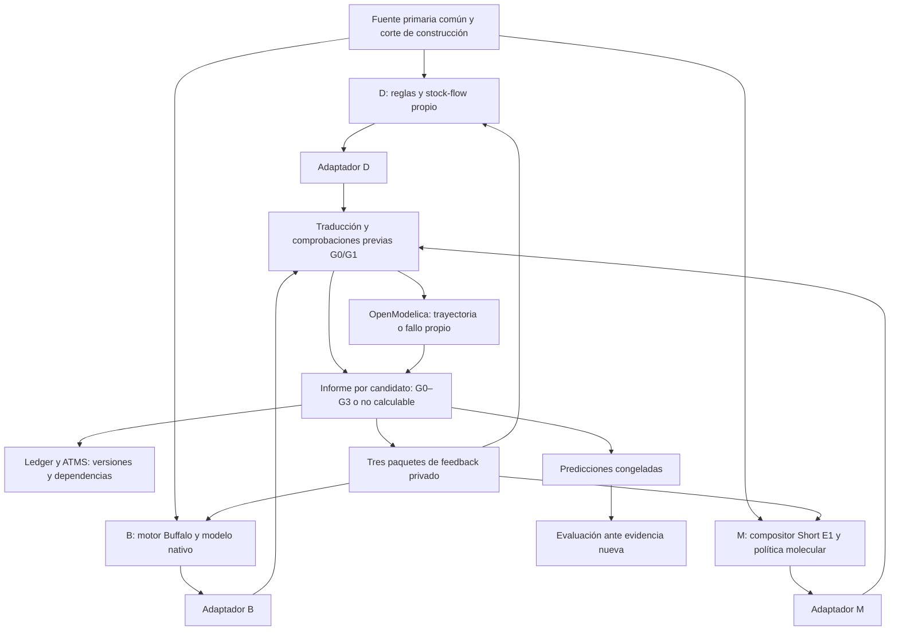

# IGC · Plan de implementación de la Arena desde R1 hacia revisión e inferencia estructural

**Versión documental:** 2.0 · **Fecha de emisión:** 27 de octubre de 2026, America/Mexico_City.  
**Repositorio canónico:** [yudocyudoc/IGC](https://github.com/yudocyudoc/IGC).  
**Corte de código verificado:** `f07d94c9109bbbb77264509bf7ed04d6aead9cba`, posterior a los PR #52, #53 y #54.  
**Estado del laboratorio:** recuperación integrada y primera ronda de intentos D/B/M cerrada, con resultado negativo propio de Buffalo. R2 y la persistencia conjunta siguen pendientes.  
**Documento compañero:** [Hoja de ruta v2.0](ARENA_IGC_HOJA_DE_RUTA_V2_0_2026-10-27.md).  
**Naturaleza:** plan de trabajo y especificación de aceptación. No certifica capacidades futuras, no crea una versión de software 2.0 y no autoriza llamadas nuevas a proveedores.

## 1. Mandato y precedencia

El siguiente trabajo debe poner a prueba la capacidad de formular y revisar mecanismos. Se reutilizan los tres brazos, los adaptadores, OpenModelica, el ledger y ATMS. No se inicia una reconstrucción de plataforma.

Este documento reemplaza las instrucciones operativas incompatibles de v1.1, v1.2 y v1.3. Conserva sus decisiones válidas: ATMS constitutivo de IGC, ledger canónico, memoria temporal, procedencia, independencia, OpenModelica y separación de construcción/evaluación. Los documentos previos y resultados históricos no se borran ni se modifican para simular continuidad.

Precedencia para el trabajo siguiente:

1. Instrucciones vigentes del investigador y autorizaciones concretas de experimentos.
2. Este plan, para tareas, interfaces y criterios de aceptación futuros.
3. La hoja de ruta, para ordenar prioridades y abrir etapas posteriores.
4. Protocolos históricos, que continúan gobernando sus propias reproducciones.

Si `main` avanza después del SHA fijado, comparar únicamente los cambios relevantes y actualizar el estado. No reiniciar R0/R1 ni ejecutar otra inferencia por una descripción antigua de «B pendiente».

### 1.1 Regla contra el rediseño prematuro

Toda propuesta de cambio debe identificar entrada, versión actual, fallo reproducible y resultado exigido. Primero se clasifica el fallo: integración, traducción, solver, hipótesis, parámetros, observabilidad, presupuesto o representación. Se prefiere una corrección localizada. Solo se propone un cambio arquitectónico cuando una prueba necesaria no puede expresarse o ejecutarse con la arquitectura actual.

**No existe en el corte una justificación para reemplazar los brazos, el compositor, ATMS o el ledger.** Sí existen limitaciones concretas: el modelo Buffalo R1 es indeterminado, M3 no ajusta parámetros, y los auxiliares históricos de revisión están ligados a artefactos específicos.

## 2. Estado real que debe heredar el coder

### 2.1 Recuperación y ronda común

| Corte | Implementación y prueba | Conclusión permitida |
|---|---|---|
| PR #52 | Recuperación M1–M3, M3-P, B3–B5, memoria D/B/M y conexión común M3 | Las capacidades avanzadas están disponibles en main |
| PR #53 | Seis candidatos D y tres M simulados sobre la fuente común | Recorrido físico D/M con métricas descriptivas |
| PR #54 | Una inferencia Buffalo original, traducción condicional, intento OpenModelica y adjudicación del fallo | Primera ronda de intentos D/B/M cerrada; B no alcanzó una trayectoria G2 |

Fuente común: pulso de **1.7 items/h durante 2 h**, entregas acumuladas **0, 0.35, 1.1, 2.5 items** en **t=0,1,2,4 h**. Es información pública de construcción. Su snapshot es:

`sha256:562204e3c4509718f8e9ce55d407477edc97bb4cbbcfc266ed50ca3777bd3c92`.

Resultados actuales, sin equivaler a un ranking científico:

| Brazo | Resultado R1 | Límite |
|---|---|---|
| D | Seis estructuras ejecutadas; menor RMSE de construcción **0.150205 items**, cuatro tiempos | Parámetros nominales declarados; estructura no identificada |
| M3 | Tres estructuras ejecutadas; menor RMSE **0.316560 items**, cuatro tiempos; **ABSTAIN** | Plantillas fijas, umbral 0.020 y margen 0.035; no selección |
| B | Modelo nativo de 17 variables y 17 relaciones; traducción condicional; **G1 negativo**, OpenModelica no construye el modelo | Sin trayectoria, sin RMSE y sin G3 calculable |

**R1 está cerrado como intento experimental**, no como éxito físico de los tres brazos. La ausencia de CSV B no debe rellenarse con ceros, una simulación reparada ni un resultado B2–B5.

### 2.2 Resultado Buffalo que inicia R2

El nativo original tiene SHA256 de bytes:

`8097496d8033bfe8b5a93eeb7d391f7c98f6bb315bdfb9e63f62b6910b437eac`.

Incluye las igualdades:

```text
congestion_multiplier = product_of_capacity_effects
product_of_capacity_effects = congestion_multiplier
```

Son dependientes y no determinan esos auxiliares. El conteo «17 ecuaciones y 17 variables» no garantiza solvencia. El log real devuelve `Failed to build model`.

La adjudicación identifica además dos discrepancias: la capacidad declarada no interviene en el flujo de terminación y el pulso nativo disminuye linealmente en su última hora, aunque el estímulo suministrado es rectangular. Son problemas de la propuesta original. No se corrigen automáticamente antes de medir la capacidad de revisión de Buffalo.

La llamada R1 ya se consumió: **1 llamada real**, **1477 tokens de entrada**, **3300 de salida** según el informe. No se reutiliza su autorización. Las tarifas no forman parte de este plan; cualquier estimación futura debe usar el consumo efectivo y una tarifa fechada.

### 2.3 Antecedentes que no deben confundirse con R2

- M3 recuperó dos casos de su familia; M3-P produjo seis abstenciones ante cambios paramétricos. Esto delimita una política, no demuestra una incapacidad del compositor.
- B4 propuso una rampa y empeoró; B5 se autocorrigió parcialmente. Ambos pertenecen a otro linaje. **Buffalo R1 → R2 no es B4 → B5.**
- Los pulsos D2/M2 y B2/B3 separaron predicciones congeladas sin una observación que adjudicara verdad.
- Clef ya tiene dos pilotos reales. No está activo como cuarto brazo V0. Clairic no tiene una prueba de extracción multimodal relevante para esta Arena.

## 3. Arquitectura que se conserva



El evaluador puede comparar modelos después de recibir las entregas. Los productores no reciben propuestas ni residuos ajenos. La memoria es un servicio común con vistas filtradas, no un canal para transmitir soluciones de un brazo a otro.

El diagrama muestra el recorrido que R2 debe conectar, no afirma que toda la persistencia conjunta esté terminada. Un error descubierto al construir el modelo puede completar un diagnóstico G1 negativo aunque los chequeos previos no lo detectaran.

| Componente | Responsabilidad | Límite |
|---|---|---|
| D | Generar y evaluar desde sus reglas explícitas | No usar moléculas ni respuestas B como motor generador |
| B | Proponer y revisar con el motor Buffalo original | No sustituir su modelo por una traducción molecular o una reparación humana |
| M | Componer, simular y seleccionar dentro de su repertorio | No inventar moléculas ni atribuir identificación a la mera existencia de un catálogo |
| Adaptadores | Transformar conservando la propuesta y declarando supuestos | No completar mecanismos ausentes de manera silenciosa |
| OpenModelica | Resolver las ecuaciones recibidas y producir trazas o errores | No declara verdadero el mecanismo |
| Evaluador | Medir fidelidad, ejecución, ajuste y discriminación | No escribe el siguiente modelo por el brazo |
| Ledger | Conservar revisiones, tiempos y artefactos | No es por sí solo un razonador |
| ATMS/memoria | Explicar soportes, dependencias y cambios del conocimiento | Un soporte lógico no garantiza adecuación empírica |

## 4. Mapa de reutilización y faltantes

Las rutas de esta tabla existen en el SHA de corte. Un archivo experimental disponible no equivale a un servicio general implementado.

| Trabajo | Reutilizar | Falta concreta |
|---|---|---|
| Fuente y vistas | `scripts/arena_v0_common_evidence.py`, `arena_v0_contract.py` | Llevar la misma identidad al segundo ciclo sin introducir evidencias privadas |
| Ronda inicial | `arena_r1_common_physical.py`, `arena_r1_buffalo_initial.py`, `arena_r1_buffalo_finish.py` | Consumir el informe adjudicado; no relanzar R1 |
| Diagnóstico B R1 | `arena_r1_buffalo_postonly.py` | Construir un paquete de revisión desde este nuevo padre |
| Buffalo | `arena_b_openrouter_cloudflare.mjs`, `arena_b_cf_protocol_adapter.mjs`, `arena_b_native_to_modelica.py`, `arena_b_construction_check.py` | Ruta de revisión R2 ligada al padre R1 y presupuesto nuevo; conservar las rutas históricas |
| Revisión histórica B | `arena_b_physical_feedback.py`, `arena_b4_blind_feedback.py`, `arena_b5_own_discrepancy.py` | Reutilizar el patrón, sin cambiar sus hashes para fingir que aceptan R1 |
| D | `arena_d_v01.py`, `arena_d_v1_screen.py`, `arena_d_v2_revision.py`, `arena_d2_revised_g2.py` | Segunda decisión sobre sus candidatos actuales; D2 necesita un ensayo adicional explícito si se usa esa política |
| M | `arena_m3_common.py`, `arena_m3_select.py`, `arena_m_visible_verify.py` | Registrar abstención y eventual revisión de política sin inventar un candidato seleccionado |
| M histórico | `arena_m2_feedback.py`, `arena_m3_param_shift.py` | M2 está ligado a M1; no aplicarlo automáticamente a M3 absteniéndose |
| Memoria | `ledger.py`, `arena_atms.py`, `arena_memory.py`, `arena_d_atms_bridge.py` | Conectar B/M y decisiones negativas al ledger real de la ronda |
| Discriminación | `arena_dm_frozen_pulse.py`, `arena_b_frozen_lowutil.py` | Obtener una observación nueva para contrastar la separación |
| Clef | `arena_clef_dual_pilot.py` | Estudio posterior de utilidad semántica incremental; no activación actual |

No se crea una segunda base de código ni se convierten todos los candidatos a un IR molecular universal. Si hace falta un módulo pequeño para el segundo ciclo, debe importar las funciones anteriores y tener una responsabilidad acotada.

## 5. Próxima entrega: R2 con una revisión Buffalo y memoria conjunta

**Pregunta:** al recibir su modelo original y su fallo real, ¿Buffalo identifica el problema, propone una revisión ejecutable o se abstiene justificadamente? ¿Puede IGC conservar esa decisión junto con los estados D y M sin alterar R1?

La entrega R2 no requiere que los tres brazos inventen nuevos modelos. D puede mantener alternativas y M conservar su abstención. Esos resultados deben ser decisiones explícitas, con causa y versión; no una etiqueta automática de «aprendizaje».

R2 prueba revisión de una formulación y memoria del ciclo. No sustituye la prueba de inferencia estructural de PT-06. Se publica su resultado tras el intento acotado, incluso negativo, y se avanza a las preguntas de estructura; no se encadenan reparaciones y auditorías hasta obtener un éxito.

### 5.1 Paquete R2 para Buffalo

Debe contener exclusivamente:

- la pregunta y la fuente de construcción ya autorizadas;
- el nativo R1 exacto como `currentModel`;
- el intento de traducción y el log propio de OpenModelica;
- el estado: no existe trayectoria física y G3 no puede calcularse;
- una petición neutral de revisar, explicar incertidumbre o abstenerse;
- el presupuesto de esta nueva revisión.

**Condición recomendada:** entregar el log y el modelo sin una reparación redactada por el evaluador. Los hallazgos detallados de `postonly` sirven para adjudicar el resultado. Si se decide entregar localización explícita de ecuaciones, identificar la condición como asistencia técnica y no compararla como diagnóstico autónomo sin ayuda. No probar ambas condiciones por defecto.

No incluir: respuestas D/M, sus RMSE, un modelo reparado, los valores de la solución esperada ni resultados B4/B5 presentados como recuerdo del mismo caso.

### 5.2 Segunda decisión de D y M

**D:** recibe sus seis trazas, supuestos y errores. Si conserva los modelos con la evidencia disponible, registra esa decisión. Si se usa D2, obtener antes el nuevo ensayo requerido por su contrato; las nuevas observaciones primarias se entregan a todos los brazos en un corte común nuevo. Nunca fabricar una observación desde el candidato D para aparentar evidencia externa.

**M:** recibe las tres trayectorias propias y el motivo de abstención. Conserva `ABSTAIN` si no cambia la política. No tiene un «modelo ganador padre». Una variante paramétrica posterior queda identificada como otro método, con una nueva decisión, no como continuación encubierta de una selección inexistente.

### 5.3 Resultados posibles de R2

| Resultado B | Registro y siguiente acción |
|---|---|
| Se abstiene | Conservar la respuesta; ciclo revisado cerrado, capacidad cuantitativa no demostrada |
| Sigue indeterminado | Registrar fallo repetido de esta hipótesis/política; no reintentar automáticamente |
| Compila pero no simula | Conservar G1/G2 diferenciados y el error concreto |
| Simula con entrada o mecanismo incoherentes | Mantener la discrepancia y sus efectos; G2 no sustituye G0/G1/G3 |
| Simula y explica mejor construcción | Reportar mejora local; no atribuir causalidad ni validación externa |

Como B R1 no tiene RMSE, **no existe un porcentaje de mejora RMSE R1→R2**. Si R2 produce una trayectoria, será su primer error de construcción calculable en este linaje. Puede informarse la transición de no ejecutable a ejecutable, separada de la calidad del ajuste.

## 6. Paquetes de trabajo y orden de implementación

Los identificadores PT son tareas de este plan, no APIs existentes. Cada paquete debe terminar en un cambio pequeño o un resultado experimental interpretable.

| Entrega | Dependencias y orden |
|---|---|
| Preparación R2 | PT-01, seguido de la preparación offline de PT-02/PT-03 |
| Ejecución y memoria R2 | Llamada PT-02 dentro de su autorización; PT-03 y conexión mínima PT-04 sobre los mismos artefactos |
| Cierre R2 | PT-05 integra las decisiones y el linaje, incluso si B vuelve a fallar |
| Prueba estructural | PT-06 es la siguiente prioridad científica; su diseño puede avanzar durante R2 |
| Contraste predictivo | PT-07, con métodos y predicciones congelados previamente |
| Aporte complementario | PT-08 condicionado a una pregunta de utilidad que los resultados D/B/M permitan formular; no bloquea PT-06/PT-07 |

### PT-01 · Consumir el cierre R1 y preparar el expediente R2

**Reutilizar:** fuente común, informe D/M y adjudicación B `postonly`.

**Trabajo:** cargar los artefactos ya archivados, conservar el padre B y las propuestas D/M, distinguir diagnóstico final de mensajes intermedios «B bloqueado». Preparar los tres paquetes de feedback desde esa misma identidad de fuente.

**Prueba concreta:** un expediente R2 reconstruye R1 como D con seis candidatos, M con tres y abstención, B con G1 negativo y sin CSV. No solicita inferencia inicial ni asigna a B un RMSE.

**Salida:** expediente listo para revisar y entradas R2 reproducibles. Cero llamadas IA, cero simulaciones necesarias para recrear bytes ya archivados. No construir un nuevo inventario general del repositorio.

### PT-02 · Conectar una revisión Buffalo desde el padre R1

**Reutilizar:** motor y transporte existentes, recepción de `currentModel`, captura antes de G0 y verificador B.

**Fallo de integración concreto:** la ruta histórica `PRIOR_SHA256` admite padres B antiguos, no el nativo R1. Probar ese rechazo con el padre R1 y un manifiesto de ensayo válido. Resolverlo mediante una entrada R2 explícita o un adaptador pequeño, sin desactivar validaciones de las reproducciones históricas.

**Trabajo:** vincular el padre y la autorización al ensayo R2, comprobar el contenido que recibe el motor y emitir como máximo una llamada nueva. Conservar nativo, respuesta cruda y recibo antes de traducir. Si el proveedor falla, mantener el intento; no generar un sustituto.

**Prueba offline de salida:** el motor recibe el padre R1 íntegro y su feedback; rechaza padre ajeno, fuente diferente y un segundo intento. Luego, con autorización disponible, ejecutar una única revisión real y G0–G3 según corresponda.

**Criterio científico:** revisar la propuesta o abstenerse cuenta como respuesta; acertar no es condición para publicar el resultado.

### PT-03 · Registrar decisiones R2 de D y M y evaluar candidatos modificados

**Reutilizar:** verificación y decisiones D/M actuales.

**Trabajo:** distinguir conservación de hipótesis, abstención, revisión paramétrica y revisión estructural. Simular solamente los modelos nuevos; si se reutilizan trazas, registrar su condición histórica. Una nueva observación externa obliga a actualizar el corte de fuente, no solo el mensaje privado a D.

**Prueba de salida:** M puede cerrar R2 conservando abstención sin candidato elegido; D puede conservar varias alternativas. Una revisión B no cambia ninguna de las salidas D/M. Ningún brazo recibe el ranking de los otros durante su revisión.

**No implementar aquí:** búsqueda molecular paramétrica extensa ni una nueva gramática D. Esas políticas pertenecen a PT-06 y se comparan separadamente.

### PT-04 · Persistir el ciclo y consultar memoria temporal

**Reutilizar:** ledger F1a, `arena_atms`, memoria y patrón del puente D.

**Trabajo mínimo:** guardar fuente, propuesta/abstención, traducción, simulación o fallo, feedback, segunda decisión y dependencias. Reutilizar los sobres y payloads existentes; crear un adaptador B/M acotado si la prueba lo exige. No migrar de almacenamiento ni diseñar ontología nueva antes de probar estas consultas.

**Consultas obligatorias:**

1. «¿Qué sabía B antes de recibir el fallo de compilación?»
2. «¿Qué propuesta, observación y supuesto justifican su revisión o abstención?»
3. «¿Qué seguía vigente en D/M cuando B cambió?»
4. «Si se retira una justificación y sobrevive otra, ¿qué hipótesis sigue sustentada?»

**Prueba de salida:** reconstrucción antes/después con `as_known_at`, continuidad del padre R1 y aislamiento por brazo. Un fallo de compilación cuestiona la ejecutabilidad de esa formulación; no debe retractar automáticamente la fuente observacional ni toda la clase de mecanismos.

PT-04 avanza junto con PT-02/PT-03. No debe convertirse en una fase de meses previa a la llamada R2.

### PT-05 · Emitir el informe conjunto R1→R2

**Trabajo:** reunir los estados finales, las métricas comparables y los costos efectivos. Separar el resultado técnico del científico y describir los límites de observabilidad, parámetros y solver.

**Prueba de salida:** R1 permanece negativo para B; R2 contiene un resultado nuevo o abstención. No aparece un RMSE ficticio para R1 B, un ganador derivado de los mínimos D/M ni una mejora atribuida a datos reservados que nadie custodió.

**Entrega:** tabla por candidato y brazo, explicación de cambios, enlace a artefactos y una decisión de siguiente experimento. Este paquete cierra R2 aunque el resultado sea adverso.

### PT-06 · Probar estructura frente a parámetros y ambigüedad

**Activación:** R2 publicado o una limitación científica concreta que pueda estudiarse sin esperar más infraestructura.

**Reutilizar:** M3 fijo como referencia, M3-P como evidencia de desarrollo, política D y simuladores existentes.

**Trabajo propuesto:** comparar M3 congelado con una política nueva de ajuste acotado por estructura. Declarar qué parámetros varían, sus límites y su origen; mantener intactas las moléculas y separar la identidad estructural de los valores ajustados.

**Prueba:** una estructura representable con parámetros distintos de la plantilla, un caso ambiguo y un caso que ninguna configuración admitida explique. La salida correcta puede ser un conjunto compatible o abstención. No prometer recuperación exacta cuando la información no identifica el mecanismo.

**Presupuesto orientativo para diseñar el primer caso:** hasta tres estructuras y nueve configuraciones por estructura, máximo 27 evaluaciones candidatas; no es autorización de ejecución ni garantía de cobertura. Si la tarea exige otro alcance, fijarlo antes de correrla. Un conjunto de seis casos multiplica ese costo; no ocultar el factor bajo un presupuesto «por estructura».

**Salida:** efecto de la búsqueda paramétrica medido frente al método fijo. No ajustar umbrales después de leer el resultado para hacer desaparecer las abstenciones históricas.

### PT-07 · Comparación predictiva con evidencia nueva y REF

**Trabajo:** fijar una referencia sencilla a partir de código disponible, una perturbación y el conjunto de predicciones antes de conocer la respuesta evaluativa. Calibrar solo en construcción. Mantener parámetros congelados al evaluar.

**Prueba de salida:** predicciones registradas antes de la medición o revelación; acceso a la reserva descrito de manera verificable; ajuste y evaluación calculados por separado. Si el generador es público y reconstruible, reportar comprobación sintética, no ceguera técnica.

**Límite:** el mínimo RMSE puede pertenecer a un modelo con más libertad paramétrica o distinta información. Reportar complejidad, presupuesto y supuestos; no atribuir una diferencia a la técnica sin controlar esas diferencias.

### PT-08 · Pilotos complementarios condicionados

Clef se estudia después del corte D/B/M: priorización semántica con repertorio previo, costo de simulaciones y falsos descartes. Clairic se estudia cuando existan documentos o imágenes que requieran extracción. Usar los mismos casos en las condiciones comparadas y separar percepción, selección y cálculo.

No crear un pipeline obligatorio Clef→Clairic ni un cuarto brazo por cambiar una etiqueta de contrato. El piloto puede terminar con la decisión de no incorporar el modelo.

## 7. Contratos de información y estados

### 7.1 Respetar el contrato existente

`ArmSubmission` acepta actualmente **PROPOSED, PARTIAL, ABSTAINED y BLOCKED**. No acepta `EXECUTABLE` ni un G2 PASS como estado emitido por el productor. Esas afirmaciones pertenecen a los informes de evaluación.

Los nombres de campos siguientes describen la información requerida; cuando no existen en los sobres actuales, son una necesidad del paquete R2, no una API que se afirme implementada.

| Registro | Contenido mínimo | Responsable |
|---|---|---|
| Fuente | Identidad, corte, observaciones, unidades, estímulo y supuestos públicos | Preparación de experimento |
| Entrega | Brazo, método, revisión, padre, nativo y supuestos | Productor |
| Traducción | Nativo de origen, Modelica y transformaciones declaradas | Adaptador |
| Evaluación | Candidato, solver, CSV o fallo, ventana, métricas y límites | Evaluador |
| Feedback | Destinatario, padre, evidencias propias, diagnóstico y presupuesto | Coordinador de ronda |
| Revisión | Qué cambió, por qué y con qué evidencia; también conservación o abstención | Mismo productor |
| Memoria | Revisiones temporales, dependencias, fuentes y permisos | Ledger/ATMS |

Un `native_artifact_sha256` calculado sobre JSON canónico y un SHA de bytes de archivo pueden diferir. Usar el tipo de hash que exige cada interfaz; no sustituir uno por otro para superar una validación.

### 7.2 Estados de evaluación

| Nivel | Pregunta | Manejo de resultado negativo |
|---|---|---|
| G0 | ¿Se preservó la propuesta al traducir? | Bloqueo o cambio explícito; no reparar silenciosamente |
| G1 | ¿Está formalmente determinada y es coherente dentro del alcance verificado? | Registrar singularidad, unidades, condiciones iniciales o conectividad |
| G2 | ¿Se ejecutaron las ecuaciones y se obtuvo una trayectoria válida? | Conservar log y ausencia de CSV; no calcular ajuste |
| G3 | ¿Qué relación tiene la trayectoria con construcción? | Error descriptivo, incompatibilidad bajo criterio o insuficiencia |
| Discriminación | ¿Se separan consecuencias de alternativas? | Conservar equivalencia si la prueba no distingue |
| Evaluación nueva | ¿Qué predijo antes de conocer nuevos datos? | Mantener el resultado sin refit retrospectivo |

Un workflow puede terminar `SUCCESS` porque capturó correctamente un G1 negativo. Ese estado de CI no significa que el modelo científico haya pasado G1/G2.

## 8. Comparabilidad y métricas

### 8.1 Lo común y lo propio

Los tres métodos comparten evidencia primaria. No se pretende que compartan el catálogo, los parámetros nominales ni el formato conceptual. D tiene supuestos explícitos propios; M tiene parámetros E1; B propone los suyos. Por eso R1 es una primera comparación descriptiva, no una estimación de superioridad metodológica.

No copiar parámetros verdaderos del mundo evaluador a un único brazo. Si un valor es una observación conocida, incorporarlo a la fuente común; si es un supuesto de método, mantenerlo como tal y estudiar su sensibilidad.

### 8.2 Tabla mínima de métricas

| Dimensión | Medida | Precaución |
|---|---|---|
| Cobertura técnica | Propuestas, traducciones, simulaciones válidas y causas de bloqueo | Mostrar denominadores y cada intento |
| Construcción | RMSE/MAE sobre tiempos explícitos | Separar todos los puntos de los puntos no iniciales |
| Física | Balance material, stocks negativos, entrada efectiva, unidades y tiempos | Comparar con el estímulo realmente recibido y con el solicitado |
| Revisión | Diferencia de estructura, parámetros, explicación y errores | Sin porcentaje RMSE si el padre no tuvo trayectoria |
| Inferencia estructural | Selección, conjunto compatible, falsos descartes y falsa certeza | Usar clases identificables, no etiquetas latentes invisibles |
| Predicción | Error sobre evidencia nueva congelada fuera del ajuste | No reutilizar datos de evaluación para mejorar la misma puntuación |
| Costo | Llamadas, tokens, simulaciones, cómputo y trabajo humano | Separar preparación, construcción, revisión, evaluación y replay |

**Ventana inicial:** t=0,1,2,4. Reportar RMSE con n=4 y con n=3 excluyendo t=0 cuando ambas magnitudes se utilicen. El selector M3 conserva su criterio original con n=4; publicar otra métrica no debe cambiar silenciosamente su decisión.

El `noise_absolute_bound=0.2` de un protocolo histórico D y el umbral M3 de 0.020 tienen funciones diferentes. No son dos mediciones de la misma precisión instrumental. Sin una cota justificada para el nuevo caso, el evaluador informa errores descriptivos.

### 8.3 Semántica numérica

D/M usan modelos continuos con DASSL en sus ensayos; Buffalo declara Euler con dt=0.125 h en R1. También existen versiones distintas de OpenModelica. Conservar esas diferencias en la reproducción histórica.

Para un experimento nuevo, fijar versiones, librerías, métodos, grillas y manejo de eventos antes de correr. Unificar el binario es útil si la paridad de las rutas lo permite, pero no imponer un solver común que cambie la semántica nativa de Buffalo. Si se alteran runtime o discretización, medir su efecto con los modelos congelados antes de adjudicar una diferencia metodológica.

La rampa que B escribió en lugar del pulso rectangular es una discrepancia de su propuesta; no se resuelve cambiando la medición para adecuarla al modelo.

## 9. Presupuestos y ejecución

### 9.1 Presupuesto propuesto para R2, sujeto a autorización de inferencia

| Recurso | Propuesta acotada | Registro |
|---|---|---|
| Inferencia B | Una llamada de revisión, sin reintentos automáticos | Nueva autorización R2, distinta de R1 |
| Salida B | Hasta 7000 tokens, reutilizando el límite ya ensayado | Confirmar el límite efectivo en el request; cualquier cambio se declara antes |
| Entrada B | Nativo R1, fuente y diagnóstico propio | Medir el prompt completo antes de enviar; completar el tope aceptado en el manifiesto |
| Simulación B | Una ejecución del modelo revisado si G0/G1 permiten avanzar | Si la traducción falla, cero ejecuciones físicas válidas |
| D/M sin cambios | Reutilización documentada de trazas y segunda decisión | No contar replay como nuevas simulaciones ni mejora |
| D/M con cambios | Límite explícito por candidato antes de ejecutar | No abrir búsqueda ilimitada bajo «feedback» |
| Revisión humana | Registrar intervención, localización de fallos y reparación, si la hubiera | Una reparación humana no se atribuye al modelo |

No hace falta gastar el presupuesto completo. La autorización histórica `BUFFALO_R1_SINGLE_INITIAL_CALL_20261026.json` no habilita otra llamada. No crear ni reutilizar marcadores para sortear esa frontera.

### 9.2 Cuatro tipos de ejecución separados

1. **Offline:** validación de contratos y contenido de entradas; sin proveedor.
2. **Replay histórico:** usa bytes ya capturados; no es una nueva inferencia.
3. **Simulación nueva:** ejecuta Modelica sobre un candidato; puede fallar.
4. **Inferencia nueva:** cambia la evidencia experimental del productor y consume autorización propia.

El campo `solver_calls=0` de un proceso Python que solo lee CSV no representa todo el costo del workflow. El informe conjunto debe incluir las ejecuciones del job OpenModelica y separar simulación de candidatos, generación de mundos y validación técnica.

## 10. Pruebas de aceptación de las siguientes entregas

La tabla es un conjunto acotado para resolver los huecos observados. No exige ampliar preventivamente una plataforma de auditoría.

| ID | Prueba concreta | Aceptación |
|---|---|---|
| R2-01 | Cargar el nativo Buffalo R1 y la adjudicación original | Se reconoce el padre correcto, un intento y ausencia de G2 |
| R2-02 | Preparar el prompt de revisión con el motor original | Contiene el modelo propio y la evidencia permitida; no incluye reparación ni rivales |
| R2-03 | Intentar padre, caso o autorización ajenos | Rechazo antes de cualquier llamada |
| R2-04 | Revisar con una llamada autorizada o declarar indisponibilidad | Se conserva la respuesta/fallo; no retry oculto |
| R2-05 | Ejecutar el candidato revisado si es admisible | Su Modelica corresponde al nuevo nativo; CSV real o fallo preservado |
| R2-06 | Construir el informe con R1 B sin CSV | G3 R1 permanece no calculable; no aparece mejora porcentual inventada |
| R2-07 | Segunda decisión M3 después de abstención | No se crea un padre seleccionado ni se traslada automáticamente M2 |
| R2-08 | Segunda decisión D sin observación nueva | Se registra conservación/revisión válida; no se fabrica el ensayo adicional D2 |
| MEM-01 | Consultar antes y después del feedback R2 | Se reconstruyen dos estados sin reescribir R1 |
| MEM-02 | Retirar una de dos justificaciones en el ciclo registrado | Sobrevive el soporte alternativo pertinente |
| MEM-03 | Consultar desde otro brazo | Solo fuente común y conocimiento autorizado, nunca su propuesta privada |
| STR-01 | Mantener identidad del caso y cambiar observaciones | Una política basada en datos responde a los datos o explica su abstención |
| STR-02 | Cambiar parámetros dentro de una estructura representable | Se distingue fallo de plantilla de falta de representación |
| STR-03 | Construcción compatible con varias estructuras | Conjunto compatible o abstención; no ganador obligatorio |
| PRED-01 | Evaluar nueva evidencia tras congelar predicciones | Sin refit ni acceso previo no declarado |

Las pruebas STR/PRED pertenecen a los paquetes posteriores. No se ejecutan todas como condición previa para estudiar una sola revisión Buffalo.

## 11. Diseño mínimo de las pruebas científicas posteriores

### 11.1 Estructura y parámetros

Fijar familias, observables, ruido y configuraciones antes de evaluar. Separar al menos:

- caso representado por la familia;
- caso de la misma estructura con parámetros distintos;
- caso ambiguo dentro del error declarado;
- caso no explicado por las configuraciones admitidas.

Un mecanismo externo al catálogo puede parecerse a uno interno bajo pocos observables. Por tanto, «fuera de familia» no garantiza que deba detectarse como tal. Definir la conclusión en términos de las observaciones y del conjunto compatible, no de una etiqueta oculta imposible de inferir.

Los filtros informativos de E1 que no cambian `deliveredTotal` no son identificables con ese observable. Evaluar recuperación de la clase material; no penalizar al método por no descubrir un componente invisible.

### 11.2 Calibración limitada

Mantener M3 como referencia congelada. La variante debe declarar topologías, parámetros libres, rangos admisibles, método de búsqueda, presupuesto y criterio de aceptación. El rango debe provenir del catálogo o de supuestos documentados; nunca de la verdad reservada del caso.

No usar los resultados M3-P para escoger valores que hagan pasar esos mismos seis casos y después llamarlos validación independiente. Pueden usarse para desarrollar una solución; su generalización se mide en casos nuevos.

### 11.3 REF y perturbaciones

REF será un modelo sencillo definido previamente, reutilizando una implementación existente. Si coincide con una subfamilia D, declararlo y evitar doble contabilización. No es un cuarto brazo de inferencia ni una referencia construida después de ver quién ganó.

Elegir perturbaciones que puedan separar las hipótesis y especificar qué observación adjudicaría el contraste. El pulso D2/M2 histórico separó parametrizaciones de una estructura común; B2/B3 contrastó ecuaciones diferentes. Mantener esa distinción.

### 11.4 Reserva y ceguera

Antes de proclamar ceguera, comprobar qué puede leer o reconstruir el constructor. Un hash, una carpeta o un timestamp no bastan si contiene el mundo evaluador o puede invocar un workflow que lo exponga.

No bloquear R2 por no disponer de un custodio completo. Ejecutar construcción y declarar su alcance. Para PT-07, usar evidencia nueva con separación efectiva o reportar honestamente la limitación de independencia. Una reserva consumida puede pasar a construcción de otra campaña, pero deja de ser reserva de validación de esa campaña.

## 12. Clef, Clairic y expansión posterior

**Clef:** conservar los pilotos numéricos y semánticos. Si se abre un experimento nuevo, comparar los mismos casos con y sin evidencia semántica y medir falsos descartes, conjuntos compatibles, calibración pertinente y simulaciones ahorradas. Si ya dispone de todas las curvas y solo debe minimizar RMSE, usar la referencia determinista fuerte. No interpretar probabilidades marginales como una distribución conjunta de estructuras sin justificarlo.

**Clairic:** extracción de medidas, tiempos y unidades desde fuentes reales del proyecto. Comparar contra transcripción de referencia y registrar ausencia de campos. La aritmética posterior se hace con código. No atribuirle calibración física ni inferencia estructural por producir un número.

**ATMS/recuperación ampliados:** vectores, RDF adicional, concurrencia y escala se abren cuando una consulta o carga relevante falle con los medios actuales. ATMS sigue siendo constitutivo; diferir su ampliación no cancela la memoria del experimento.

**Políticas e intervenciones reales:** horizonte posterior. No diseñar ahora un sistema de despliegue, decisión empresarial o actuación autónoma como requisito de este plan.

## 13. Trabajo de repositorio y condiciones de entrega

1. Trabajar desde el `main` real de GitHub. La carpeta local `IGC-recovery/` es una copia del corte #52, no un clon actualizado al #54; no usarla como fuente actual sin traer los cambios posteriores.
2. Mantener los protocolos históricos y sus resultados negativos. PR #51 no debe reintroducir M0 sobre la ronda recuperada; su incorporación parcial está documentada en #52.
3. Promover por capacidad y con pruebas. Una fusión documental o un test mock no convierte en ejecutada una inferencia.
4. Separar workflow offline, replay y llamada real. Una CI que registra correctamente un modelo fallido puede ser verde sin falsificar el resultado.
5. Conservar evidencia mínima durable por experimento: nativo, entrada, log, métricas, fuente y recibo. Los artefactos de Actions tienen caducidad; preservar el paquete necesario antes de que expire, sin emprender por ello una plataforma nueva de almacenamiento.
6. Actualizar el estado operativo al cerrar cada paquete; evitar que documentos históricos de «B bloqueado» gobiernen una ronda cuya llamada ya ocurrió.

No publicar un tag V0.1 solo porque las fuentes están integradas. La versión del software requiere la definición de alcance y las pruebas del recorrido correspondiente.

## 14. Definición de terminado y responsables

| Corte | Condición de término | No implica |
|---|---|---|
| R0 | Capacidades recuperadas y CI de integración | Arena científica completa |
| R1 | Tres productores intentados sobre la misma fuente y resultados propios documentados | Tres simulaciones exitosas, ni ganador |
| R2 | Una segunda decisión por brazo, feedback propio y memoria temporal del ciclo | Mejora de todos los modelos |
| R3 | Contraste interpretable de estructura, parámetros y ambigüedad | Identificación universal |
| R4 | Predicciones congeladas evaluadas ante evidencia nueva | Causalidad válida para cualquier sistema |

**Investigador:** define la pregunta, acepta el alcance experimental y autoriza el presupuesto concreto de nuevas llamadas. No necesita volver a aprobar una corrección reversible ya autorizada ni cada lectura de artefactos.

**Coder:** prepara entradas y adaptadores, conserva los métodos, ejecuta pruebas y presenta resultados; no arregla una hipótesis de un brazo para mejorar su puntuación.

**Revisor:** examina el experimento concreto y sus límites; identifica una prueba fallida antes de recomendar un rediseño. No amplía la lista de controles sin relación con el resultado que se intenta interpretar.

**Próxima acción concreta:** PT-01 y preparación offline de PT-02, con PT-04 mínimo en paralelo de trabajo. La llamada R2 se ejecuta solo cuando su nueva autorización y sus topes estén disponibles. Después se publican el resultado y la segunda decisión D/M, sin prolongar R2 por el deseo de obtener una respuesta favorable.

## 15. Fuentes verificadas y alcance de esta revisión documental

Se verificaron el SHA actual de main, los PR fusionados, los módulos relevantes, los documentos de resultados y los logs que distinguen inferencia real, simulación fallida y adjudicación posterior. Esta elaboración no ejecutó nuevas inferencias ni alteró código.

- [PR #52: recuperación](https://github.com/yudocyudoc/IGC/pull/52).
- [PR #53: D/M físicos](https://github.com/yudocyudoc/IGC/pull/53) y [ejecución 40450646600](https://github.com/yudocyudoc/IGC/actions/runs/40450646600).
- [PR #54: Buffalo inicial y diagnóstico](https://github.com/yudocyudoc/IGC/pull/54), [llamada real 40452596916](https://github.com/yudocyudoc/IGC/actions/runs/40452596916) y [adjudicación sin inferencia 40453262004](https://github.com/yudocyudoc/IGC/actions/runs/40453262004).
- [Resultado R1 fijado al corte](https://github.com/yudocyudoc/IGC/blob/f07d94c9109bbbb77264509bf7ed04d6aead9cba/docs/ARENA_R1_PRIMER_CORTE_TRES_BRAZOS_RESULTADO_2026-10-26.md).
- [Código del diagnóstico B](https://github.com/yudocyudoc/IGC/blob/f07d94c9109bbbb77264509bf7ed04d6aead9cba/scripts/arena_r1_buffalo_postonly.py), [evaluación D/M](https://github.com/yudocyudoc/IGC/blob/f07d94c9109bbbb77264509bf7ed04d6aead9cba/scripts/arena_r1_common_physical.py) y [contrato común](https://github.com/yudocyudoc/IGC/blob/f07d94c9109bbbb77264509bf7ed04d6aead9cba/scripts/arena_v0_contract.py).
- [M3-P](https://github.com/yudocyudoc/IGC/blob/f07d94c9109bbbb77264509bf7ed04d6aead9cba/docs/ARENA_M3_P_VARIACION_PARAMETRICA_RESULTADOS_2026-10-26.md), [B5 histórico](https://github.com/yudocyudoc/IGC/blob/f07d94c9109bbbb77264509bf7ed04d6aead9cba/docs/ARENA_B5_AUTOCORRECCION_B4_REAL_2026-10-26.md) y [pilotos Clef](https://github.com/yudocyudoc/IGC/blob/f07d94c9109bbbb77264509bf7ed04d6aead9cba/docs/ARENA_CLEF_DOS_PILOTOS_REALES_RESULTADOS_2026-10-26.md).

Las cifras de R1 se atribuyen al informe y a sus ejecuciones originales. Se confirmó en logs la llamada única, el fallo de construcción del modelo y el cierre negativo reproducido; no se descargaron de nuevo todos los CSV para recalcular cada RMSE. Las tareas PT-01…PT-08 son propuestas de implementación posteriores al corte.
