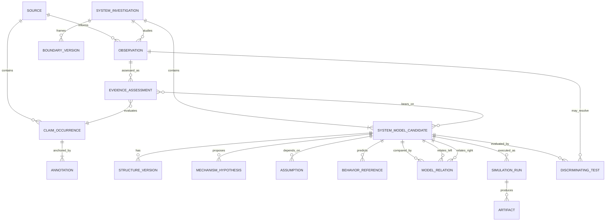

# ERD conceptual IGC

**Estado:** modelo conceptual derivado de la especificación v0.2; no es esquema LinkML, D1 ni RDF implementado. Cardinalidades son propuestas iniciales.

## Entidades y responsabilidades

- **Source:** documento/dataset con identidad, versión, hash, fecha y política de acceso.
- **ClaimOccurrence:** acto/proposición atribuida a una fuente y ubicación concreta; no representa por sí sola el hecho real.
- **Annotation:** anclaje del contenido mediante selector y rango conforme a Web Annotation.
- **Observation:** medición, entrevista o registro del sistema, con método, tiempo, unidades, contexto e incertidumbre.
- **EvidenceAssessment:** evaluación trazable que apoya, cuestiona o limita una proposición/modelo, sin equivaler automáticamente a causalidad.
- **SystemInvestigation:** frontera, comportamiento de referencia, horizonte y preguntas de investigación versionados.
- **SystemModelCandidate:** candidato explicativo versionado con estados parciales/ejecutables y relaciones a evidencia, supuestos y pruebas.
- **BoundaryVersion / StructureVersion:** versiones explícitas para distinguir cambios de frontera de cambios estructurales.
- **MechanismHypothesis / Assumption:** explicación o supuesto requerido, rastreable y retractable; un ATMS puede mantener conjuntos de justificación.
- **BehaviorReference:** patrón observado o requerido, separado de una trayectoria simulada.
- **ModelRelation:** relación justificada entre candidatos (`competing`, `compatible`, `nested`, `complementary`, `undetermined`).
- **SimulationRun:** ejecución reproducible con backend, versión, parámetros vinculados por backend, solver, timestep, logs y hashes.
- **Artifact:** salida inmutable asociada al run, como CSV, log, modelo generado o figura.
- **DiscriminatingTest:** observación/intervención propuesta con predicciones por candidato y criterio `NON_DISCRIMINATING` posible.

## Restricciones de modelado

1. Persistir tiempos de validez y tiempos de registro cuando la reconstrucción histórica lo requiera.
2. Mantener observación externa separada de salida simulada.
3. La relación entre candidatos no implica exclusión: requiere justificación.
4. Evidencia, similitud semántica, consistencia estructural y soporte causal son estados distintos.
5. No almacenar valores sensibles/números del sistema como parte de un prompt LLM si la política lo prohíbe.
6. Revisar cardinalidades, identidad estable y política de borrado antes del esquema físico.
