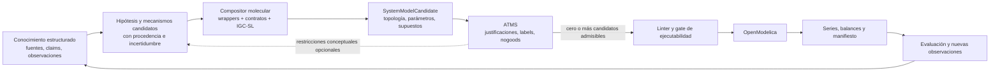

# Diseño de flujo FM-B: composición molecular y razonamiento ATMS

**Estado:** diseño para revisión; no implementa ni declara aprobado el gate FM-B.

**Base de trabajo:** rama FM-A `fm-a-molecular-contract`, HEAD observado `0b84038e34b19407bff20830e2c15a0c7a57b117`.

**Alcance:** definir el orden y los contratos entre conocimiento estructurado, wrappers moleculares, composición, ATMS y OpenModelica. El uso de wrappers existentes de `short` queda indicado por el investigador; la revisión de licencias se conserva como asunto final y separado.

## Decisión de arquitectura

En la selección central de modelos, el ATMS recibe candidatos estructurales ya compuestos. Las moléculas aportan piezas e interfaces para formar mecanismos; el ATMS mantiene los entornos de supuestos que sostienen cada candidato y las incompatibilidades que afectan esos entornos. El ATMS no genera ni modifica ecuaciones, conexiones o topologías.

El orden es iterativo, no una tubería irreversible. El ATMS puede evaluar restricciones conceptuales antes de componer para evitar trabajo inviable, y puede revisitar etiquetas después de simulaciones u observaciones. Esa intervención anticipada es una optimización; la selección ATMS de candidatos moleculares ocurre después de que el compositor materialice sus estructuras.

## Contratos entre componentes

### 1. Conocimiento y mecanismos

La entrada conserva por separado el contenido de la afirmación, su ocurrencia en una fuente, las observaciones y la modalidad epistemológica. Un `MechanismHypothesis` o equivalente declara entidades, relaciones causales propuestas, referencias, supuestos, incógnitas y alcance. No se transforma automáticamente una afirmación textual en una ecuación.

El puente RDF/SPARQL existente puede aportar propuestas tipadas y trazables. Sus fixtures actuales no se tratan como descubrimiento automático: las alternativas y reglas de mapeo siguen siendo explícitas y sintéticas.

### 2. Wrappers y composición

El catálogo de wrappers proporciona definiciones versionadas, interfaces, unidades, parámetros e invariantes. El compositor recibe hipótesis y restricciones, consulta ese catálogo y produce cero o más estructuras. No conoce IDs especiales como `CS-01`, nombres de casos, ni la identidad de un supuesto ganador.

La estructura y los parámetros se versionan y hashean por separado. Conectar wrappers no los hace automáticamente admisibles: una etapa de validación técnica comprueba interfaces, dirección, clase de enlace, tipos, unidades, entidades y reglas de composición. Los adaptadores requeridos deben ser explícitos; una conexión informativa nunca transporta flujo material.

Salida mínima por candidato:

- `candidate_id`, `request_id`, `structure_revision_id` y snapshot del catálogo;
- instancias de wrappers con versión y referencia de fuente;
- conexiones tipadas y hash estructural independiente de parámetros;
- bindings conocidos, ausentes o sintéticos, cada uno con unidad y procedencia;
- supuestos requeridos y referencias de evidencia;
- estado de validación y lista localizada de problemas.

La salida puede incluir alternativas parciales o bloqueadas para conservar incertidumbre. Solo candidatos técnicamente válidos pasan a ejecución; un candidato sin soporte ATMS no se convierte por esa razón en código inválido, y uno con soporte ATMS no se vuelve ejecutable sin pasar el gate técnico.

### 3. ATMS después de la composición

El ATMS consume los candidatos compuestos y sus dependencias declaradas. El vínculo de soporte debe identificar qué hipótesis, evidencias, reglas y supuestos sustentan cada candidato o parte de su estructura.

- Conserva todos los candidatos que tengan al menos un entorno consistente; no impone `top-1`.
- Un `nogood` descarta únicamente los entornos que lo contienen. Si existen justificaciones alternativas, el candidato permanece soportado por las restantes.
- Una incompatibilidad solo puede podar un candidato cuando está declarada, versionada y trazada a su justificación. La diferencia estructural entre dos candidatos no es por sí misma un `nogood`.
- La selección produce un artefacto verificable con hashes de candidatos de entrada, justificaciones, supuestos, `nogoods`, versión del selector y entornos resultantes.
- El ATMS no asigna verdad causal, no completa parámetros y no altera la topología.

Esta separación permite comparar dos preguntas diferentes: qué estructuras puede construir el vocabulario molecular y bajo qué supuestos se sostiene cada una.

### 4. Ejecución y retorno de evidencia

El gate de ejecución filtra por validez técnica y estado de admisión del wrapper, conserva el motivo de cualquier abstención y entrega a OpenModelica cada candidato admisible que tenga soporte consistente. El simulador no recibe una selección ganadora implícita.

Cada ejecución queda vinculada al ID y hash de estructura, bindings, supuestos/labels usados, versión del generador o adaptador, OpenModelica/solver, artefactos CSV y manifiesto. La comparación de modelos se calcula desde las series producidas, con la misma entrada y observables acordados. Si las series no distinguen estructuras, el resultado es `NON_DISCRIMINATING`.

Una simulación puede generar observaciones para revisión semántica. Estas actualizan conocimiento y labels mediante una nueva revisión; no reescriben retroactivamente los supuestos utilizados en una corrida anterior.

## Orden de entrega propuesto

1. **B0 — Recuperación reproducible de wrappers:** fijar commit y archivos fuente de `short`, restaurar las clases seleccionadas en el árbol de trabajo IGC con atribución de procedencia, comprobar importación/compilación aislada y registrar los límites. En esta entrega no se construyen políticas ni ecuaciones nuevas.
2. **B1 — Compositor molecular:** dado un request y catálogo, componer candidatos estructuralmente distintos; comprobar diffs de topología y negativos de interfaces sin invocar ATMS ni OpenModelica.
3. **B2 — ATMS por candidato:** derivar/adjuntar soportes a los candidatos existentes, verificar justificaciones alternativas y poda localizada con `nogoods`; comparar el resultado con filtro simple y cierre OR/AND. S0 puede seguir dando `NOT_DEMONSTRATED`.
4. **B3 — Gate y ejecución:** enviar todos los candidatos con soporte consistente y técnicamente admitidos a OpenModelica; producir series, manifiestos y `verify-selection`/`verify-handoff` que reconstruya la relación entre propuestas, selección y ejecuciones.
5. **B4 — Comparación y cierre:** evaluar observables, persistir revisiones sintéticas en el ledger y registrar diferencias, equivalencias o bloqueos. No declarar ganancia científica por tener más candidatos o simulaciones.

Un límite descubierto en B0 o B1 se documenta como `BLOCKED_WITH_CAUSE`; no se crea un wrapper nuevo ni una política faltante dentro de este plan. La pareja CS-01/CS-02 sigue siendo una fixture estructural hasta que supere B0/B1 y la decisión experimental correspondiente.

## Pruebas que distinguen este flujo del prototipo actual

1. Compositor produce al menos dos candidatos con hashes estructurales distintos antes de ejecutar el selector ATMS.
2. Cambiar únicamente un supuesto cambia labels/soportes, pero no el hash topológico.
3. Un `nogood` elimina solo el entorno que lo contiene; una justificación alternativa mantiene vivo el candidato.
4. Varios candidatos consistentes llegan al gate de ejecución; el sistema no exige un único ganador.
5. Wrapper, parámetro o enlace inválido se rechaza aunque ATMS dé soporte al candidato.
6. Alterar después de la selección el catálogo, candidato, supuestos, selección o CSV es detectado por la verificación de hashes/procedencia.
7. La ablación informa por separado resultado del filtro simple, cierre OR/AND y ATMS; el valor añadido puede quedar `NOT_DEMONSTRATED`.

El cableado de PR #5/#6 permanece como regresión de integración, pero no satisface estas pruebas porque usa candidatos `single_stock` prefijados y un probe ATMS previo a la disponibilidad de estructuras moleculares.

## Límite de esta propuesta

Este documento concreta el orden de arquitectura y los contratos para diseñar FM-B; no cambia PR #7 ni sus gates de FM-A, no autoriza fusiones, no habilita datos reales ni despliegue cloud. La instrucción de usar los wrappers permite planear su recuperación para B0, pero no convierte el resultado en una licencia o en aprobación científica. La revisión formal de licencias queda al final, como indicó el investigador; se registrará por archivo y por dependencia antes de cualquier distribución o declaración de admisión jurídica.
