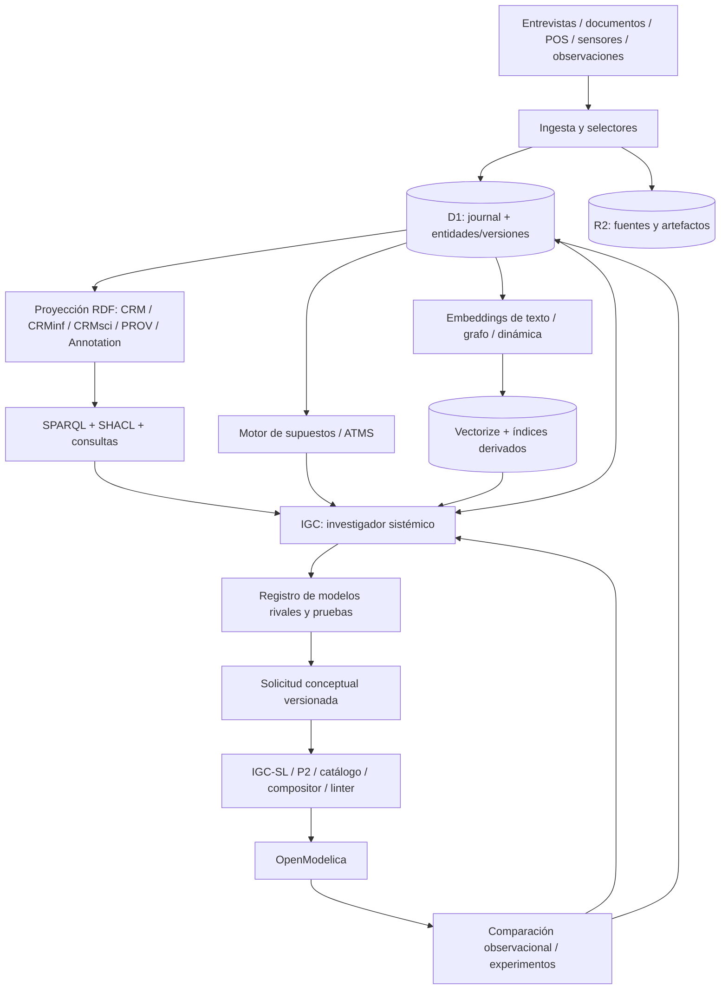

# IGC — Núcleo de conocimiento sistémico y laboratorio de modelado dinámico

## Especificación integral de arquitectura y experimentación · v0.2 · 2026-10-19

**Estado:** PROPUESTA COMPLETA PARA ADJUDICACIÓN DEL INVESTIGADOR. **No es una implementación, no certifica compatibilidad ni aprueba automáticamente cambios del repositorio.**  
**Repositorio de destino:** [`yudocyudoc/short`](https://github.com/yudocyudoc/short); subproyecto aislado, integración mediante contratos versionados.  
**Responsabilidades:** investigador decide alcance y adjudica resultados; coder implementa y demuestra; revisor independiente inspecciona pruebas y contratos.  
**Sustituye como propuesta:** la orientación de *IGC Declarativo v0.1* limitada a expediente de afirmaciones. Conserva sus principios de procedencia, temporalidad, incertidumbre y no filtración de respuestas.  
**Decisión del investigador incorporada el 19 de octubre de 2026:** todos los estudios del IGC usan **Dinámica de Sistemas como lente rector**; **OpenModelica es destino de formalización y motor de simulación obligatorio**, aun si algunas hipótesis iniciales son parciales y no ejecutables. No se acepta sustituir el programa de investigación por análisis lineales o tablas de Excel.  
**Ambición de ingeniería:** **implementar e integrar todas las familias tecnológicas planificadas** para evaluar capacidad, límites, compatibilidades y configuraciones; no optimizar para producto inmediato ni excluir una tecnología porque su beneficio todavía no esté demostrado. Integración plena se comprueba, no se presume.  
**Alcance documental:** arquitectura objetivo, vocabulario, contratos de entidades, modelos de persistencia y sincronización, inferencia, experimentación, gates y mandato para Codex. Los ejemplos de datos/modelos son **sintéticos y no afirmaciones sobre una cafetería real**.

---

## 0. Decisión ejecutiva: qué construimos y qué investigamos

**Objetivo científico-técnico.** Construir un laboratorio capaz de incorporar conocimiento heterogéneo de un sistema real; representarlo semántica, epistemológica y sistémicamente; mantener **múltiples modelos dinámicos candidatos**; generar y formalizar estructuras de SD; ejecutar y contrastar dichas estructuras mediante OpenModelica; planear nuevas observaciones o intervenciones cuando sean posibles; registrar discrepancias y revisar **estructura, frontera, supuestos y parámetros** de los modelos. Medir qué aporta cada familia tecnológica, con y sin LLM, frente a comparadores sólidos.

**Hipótesis investigable H-IGC.** Dada la misma evidencia accesible y los mismos recursos de modelado, disponer de conocimiento sistémico tipado, procedencia trazable, razonamiento de supuestos, recuperación semántica y análisis de estructuras podría mejorar la calidad estructural, dinámica, discriminante y reproducible de modelos SD frente a flujos que usan documentos y/o LLM sin este núcleo. Esta mejora **no está demostrada**. Puede ser nula, negativa, dependiente del dominio o dominada por el trabajo de curación previo.

**No confundimos:** (i) fuente y realidad; (ii) proposición y mecanismo; (iii) similitud vectorial y causalidad; (iv) consistencia de una ontología y veracidad empírica; (v) justificación ATMS y probabilidad; (vi) AST tipado y sistema correcto; (vii) simulación plausible y mecanismo identificado; (viii) desempeño de un caso y capacidad general; (ix) infraestructura integrable y desempeño científico validado.

**El núcleo central no es una única afirmación.** La unidad operativa de investigación es `SystemInvestigation`, con un **espacio versionado de `SystemModelCandidate`** que refiere a observaciones, estructuras, mecanismos, supuestos, fronteras, comportamientos, ejecuciones, alternativas y pruebas. `ClaimOccurrence` sigue siendo unidad fundamental de atribución documental; ninguna sustituye a la otra.

**Principio de plataforma completa:** todas las capacidades listadas en §3 deben contar con implementación reproducible e integración vertical; su activación en cada experimento es configurable. *Implementar todo* no exige operar todos los motores en cada corrida ni fingir equivalencias semánticas entre ellos.

### 0.1 Criterios de cumplimiento integral

La plataforma **no** se declarará completa hasta que demuestre, con pruebas y trazas reproducibles: ingestión de un documento y un dataset; anclaje Web Annotation; grafo PROV/CRMinf/CRMsci válido; esquema LinkML validado; consulta SPARQL; evaluación por SHACL; revisión de supuestos mediante ATMS; recuperación vectorial; comparación de estructuras y comportamientos; al menos dos candidatos SD; traducción por contratos IGC-SL; **simulación real con OpenModelica**; contrastación contra observación; reconstrucción temporal; y persistencia íntegra en Cloudflare D1/R2. Los módulos pueden implementarse por oleadas, pero ninguno se elimina silenciosamente del objetivo.

### 0.2 Qué modifica de documentos anteriores

- Conserva la v0.1: separación acto de afirmar/contenido, etiquetas CEI, contexto, historial no destructivo, gates, abstención, privacidad, actor sin permiso de intervenir.
- Integra el dictamen de Qwen **parcialmente**: referentes, mecanismos, preguntas, reencuadres, intervenciones y bridge tipado son capacidades necesarias; se evita obligar a que todo referente sea `STOCK` o que toda hipótesis ya tenga estructura ejecutable; hipótesis rivales pueden coexistir.
- Integra la investigación profunda del 19/oct: CRMinf/CRMsci, PROV-O, Web Annotation, LinkML, SHACL, RDF, SQLite/D1, TMS/ATMS, extensibilidad, prohibición de DSL epistemológico propio injustificado.
- **Modifica expresamente** la orientación de `CEI_SD_direccionn_actualizada_2026-10-07.md` y una frase de la hoja v5.1 que trataban SD como opcional: **para esta iniciativa SD es el marco universal de investigación y OpenModelica es obligatorio**. La tabla/estadística es fuente, medición o comparador, nunca sustituto del programa de modelado. Se registra esta divergencia; no se reescriben documentos anteriores como si hubieran dicho lo mismo.
- Conserva de v5.1 la separación niveles, moléculas verificadas, linter L0–L6, límites `NO_MATCHING_MOLECULE`/`POLICY_UNIMPLEMENTED`, precedentes P1/P2/P5 y experimentos adversativos. **No afirma que PR #20 ni #40 sean ejecutables o fusionados.**

---

## 1. Fundamentos: SD, agente-campo, modelos rivales

### 1.1 Invariantes científicos rectores

**SD-01.** Toda investigación declara `system_boundary`, `reference_behavior`, escalas temporales, agentes/campos relevantes, acumulaciones candidatas, flujos o incertidumbre sobre su identificación, políticas y posibles feedbacks/retardos. Es lícito registrar `unknown`, pero **no omitir** la pregunta sistémica.

**SD-02.** Una observación puntual o un modelo local (p. ej., colas) se integra como subsistema o mecanismo de un modelo de sistema; no reemplaza por sí solo la explicación dinámica del sistema.

**SD-03.** Los roles `STOCK/FLOW/SIGNAL/CONTROL` son **hipótesis de modelado** con versión y alcance, no propiedades inherentes de una persona, documento o palabra.

**SD-04.** Una acumulación tiene entradas, salidas, unidades y tiempo; todo componente que entra al backend cumple integridad dimensional, topológica y contratos dinámicos. Cuando no se conozcan ecuaciones o parámetros, permanece **parcial/no ejecutable**, no se inventan datos.

**SD-05.** Varios candidatos pueden compartir estructura y diferir en mecanismos, fronteras, supuestos o parámetros. Son `competing`, `compatible`, `nested`, `complementary` o `undetermined` **con justificación**, no necesariamente excluyentes.

**SD-06.** Un `SimulationRun` prueba consecuencias matemáticas **condicionales al modelo**. La observación externa es distinta de la serie simulada. Reproducir historia no identifica estructura causal.

**SD-07.** El ciclo completo es `observación → estructuras rivales → formalización → ejecución → contrastación → diseño de prueba → nueva observación → revisión`. Se admiten callejones sin salida y mecanismos no representables.

**SD-08.** La fidelidad se examina en al menos estructura, dimensiones, comportamiento, extremos, sensibilidad, predicción fuera de muestra y, cuando sea factible/ético, respuesta a intervenciones. No se infiere de una sola métrica de ajuste.

**SD-09.** Se distingue entre **campo percibido por cada actor** y **campo reconstruido por el investigador**; una actualización de IGC no equivale a cambio perceptivo del actor.

**SD-10.** Toda pregunta discriminante especifica las predicciones por modelo y supuestos. Si varios candidatos predicen lo mismo, registra `NON_DISCRIMINATING`; no fabrica contraste.

### 1.2 Dos funciones legítimas del investigador

- `intervening_actor`: existe capacidad legal/operativa de modificar algunas condiciones; una intervención real precisa autorización, alcance, reversibilidad, daño y medición.
- `observer`: no tiene autoridad para actuar sobre el sistema; puede entrevistar, observar, buscar archivos, analizar contrafactuales simulados y proponer pruebas posibles a terceros. No se le asignan controles inexistentes.

### 1.3 Cobertura de escala

Un agente a una escala puede ser campo para otro. `Agent`, `Field`, `Boundary`, `RoleInContext` son relaciones con contexto y periodo, no taxonomías exclusivas; conservar múltiples campos superpuestos y efectos retardados/ecos de campo. La frontera de trabajo es selectiva y revisable.

---

## 2. Preguntas que la plataforma DEBE poder contestar

| ID | Pregunta verificable | Motor primario |
|---|---|---|
| CQ-01 | ¿Quién afirmó X, dónde exactamente, en qué fecha, con qué modalidad? | Anotaciones + procedencia |
| CQ-02 | ¿Qué observaciones externas apoyan o cuestionan X sin probar su causalidad? | CRMinf/CRMsci + evaluación |
| CQ-03 | ¿Cuáles son los mecanismos alternativos que podrían generar el comportamiento Y? | Investigación + grafo de modelos |
| CQ-04 | ¿Cuáles comparten stocks, políticas, fronteras o feedbacks? | Ontología sistémica + comparación estructural |
| CQ-05 | ¿Qué supuestos hacen admisible a cada candidato y qué ocurriría si se niegan? | ATMS + grafo de dependencias |
| CQ-06 | ¿Qué datos/modelos nuevos son semántica o estructuralmente análogos? | Vectorize + KGE + búsqueda estructural |
| CQ-07 | ¿Qué conexiones propuestas no cumplen tipos, conservación o causalidad identificable? | Linter + informe epistemológico separado |
| CQ-08 | ¿Qué variantes pueden formalizarse en OpenModelica y cuáles requieren datos, mecanismos o políticas? | Bridge + backend |
| CQ-09 | ¿Qué modelos reproducen el comportamiento de referencia y cuáles divergen? | OpenModelica + evaluación |
| CQ-10 | ¿Qué observación/intervención distingue modelos y bajo qué supuestos? | Diseño de pruebas + sensibilidad |
| CQ-11 | ¿Qué se sabía/creía antes de incorporar evidencia reciente y qué se revisó? | D1 bitemporal + journal |
| CQ-12 | ¿Qué relación surgió por similitud vectorial, por regla, por texto o por observación? | Procedencia de derivación |
| CQ-13 | ¿Cuál es la magnitud de mejora, si la hay, frente a LLM+documentos y al comparador SD experto? | Banco experimental ciego |
| CQ-14 | ¿Podemos distinguir estructura equivocada de parámetros deficientes o medición defectuosa? | Pruebas discriminantes y de identificabilidad |
| CQ-15 | ¿Qué parte del razonamiento puede operar sin LLM a partir de datos ya estructurados? | Experimentos por ablación |

**Gate conceptual:** cada pregunta debe mapearse a una operación real, fixtures positivos/negativos, resultado legible y ruta de código. Las tablas son compromisos a demostrar, no alegaciones de funcionalidad existente.

---

## 3. Capacidades y estándares obligatorios del laboratorio

| Componente | Capacidad completa a explorar | Implementación elegida inicialmente | Qué NO se supone |
|---|---|---|---|
| **CIDOC CRM + CRMinf** | Proposiciones, creencias, adopciones, inferencias, procedencia de argumentos | Ontologías oficiales fijadas por versión + mapeo + instancias RDF + consultas | CRMinf no es una base de datos ni un solucionador causal |
| **CRMsci** | Actos de observación, mediciones, instrumentos y resultados | Ontología oficial, patrones y datos de observación | Registro instrumental no implica atribución causal |
| **PROV-O** | Actividades, entidades, agentes, derivación, versiones y linaje | Named graphs / serialización y consultas | PROV no adjudica veracidad |
| **Web Annotation** | Citas localizables con selectores y estado del recurso | Data model W3C con text quote/position, tiempo, filas cuando proceda | Un selector no verifica por sí solo integridad del contenido |
| **LinkML** | Contrato declarativo multiformato, validadores y artefactos generados | YAML canónico versionado → JSON Schema / Python / JSON-LD / SHACL según capacidad comprobada | Esquema válido ≠ modelo sistémico correcto |
| **RDF / SPARQL / OWL** | Conocimiento semántico, consultas y entailment delimitado | RDFLib + PyOxigraph inicialmente; Jena opcional como backend alterno ensayable | Mundo abierto OWL ≠ validación closed-world |
| **SHACL** | Restricciones RDF cerradas declaradas y pruebas de conformidad | Estándar W3C estable (REC 2017) + pySHACL; 1.2 solo experimental | SHACL no prueba causalidad |
| **ATMS** | Etiquetas de entornos, justificaciones, supuestos, conflictos y escenarios | Motor seleccionado tras auditoría o implementación propia fiel y testeada | ATMS no da probabilidades ni detecta causas por sí mismo |
| **LLM** | Extracción, normalización, propuestas y crítica con traza | Interfaz intercambiable y fixtures ciegos | No edita verdad canónica sin aprobación |
| **Búsqueda textual** | Coincidencia exacta y filtrada | SQLite FTS5 donde esté soportado y comprobado en D1 | No equivale a semántica |
| **Embeddings de texto** | Recuperación y analogías conceptuales | Cloudflare Vectorize + proveedor embedders versionado | Similitud ≠ implicación ni causalidad |
| **Embeddings de grafo (KGE)** | Predicción candidata de enlaces tipados y analogías relacionales | PyKEEN u otra librería comprobada en contenedor | Grafo pequeño puede ser insuficiente para entrenamiento |
| **Firmas dinámicas/series** | Recuperación de comportamientos y modelos observacionalmente próximos | Métodos clásicos + representaciones aprendidas ensayables | Serie similar ≠ estructura similar |
| **IGC-SL/P2** | Solicitud conceptual, IR tipado, compositor, linter, moléculas | Adaptador versionado, evolución coordinada con P2 | No declarar funcionalidades del PR como disponibles hasta CI |
| **OpenModelica** | Compilación, simulación, sensibilidad, extremos, reproducibilidad | `omc` + OMPython / scripting fijados por versión | Compilación correcta ≠ modelo verdadero |
| **D1 / R2 / Workers** | Persistencia, artefactos, acceso, auditoría, jobs | Cloudflare con doble ejecución local/cloud | Workers no ejecuta directamente stacks Python/OM |
| **GitHub CI** | Código, fixtures, reproductibilidad, matrices y auditoría independiente | Actions + Docker + worktree/rama aislada | Acciones CI no equivalen a servidor de ejecución permanente |

**Especificación de versiones:** fijar por SHA/imagen/artefacto en `stack.lock.yaml` versiones concretas verificadas; no copiar fechas o ejemplos de documentación como garantía de compatibilidad. Licencia, mantenimiento y procedencia de ontologías/librerías obligatorios en `THIRD_PARTY.md`.

**Estado del arte y elección:** CRMinf/CRMsci/PROV/Web Annotation/LinkML son **familias complementarias**. La expresión «framework completo» significa una plataforma **integradora** y configurable, no que exista un framework monolítico que haga todo.

---

## 4. Arquitectura lógica de responsabilidades



**No prescribe microservicios.** Se puede implementar como monorepo con un servicio Python contenedorizado, un Worker API, un almacén D1/R2 y dependencias locales para pruebas.

### 4.1 Propietario de cada verdad operativa

| Registro | Autoridad |
|---|---|
| Fuente, hash, anotación, eventos, actores, evaluaciones admitidas, estado de investigación | Ledger canónico D1 + objetos inmutables R2 |
| RDF/OWL/CRMinf/CRMsci, índices SPARQL, cachés de búsqueda, embeddings | Proyecciones derivadas reproducibles, versionadas, reconstruibles |
| Entornos ATMS / nogoods | Estado derivado de justificaciones **versionadas**, con huella del algoritmo y snapshot |
| Estructura de candidatos y roles SD hipotéticos | Registro canónico `SystemModelCandidate` y `SystemStructureRevision` |
| AST Modelica, bibliotecas de moléculas y ejecutabilidad | Backend IGC-SL/OpenModelica con trazas en ledger |
| Corrida simulada | Artefacto de simulación condicional; nunca observación del mundo |
| Revisión científica | Evaluación motivada, decisión del investigador o regla previamente autorizada; no promoción automática por LLM |

**Regla:** la sincronización SQL↔RDF↔Vectorize no genera varias fuentes de verdad. Una proyección fallida es fallo de proyección, no mutación de registros históricos. Se conserva `source_event_offset`, `projection_version`, `digest`, `status` y reconciliación.

### 4.2 Plan de despliegue

- **Desarrollo y CI:** contenedores Linux locales/GitHub Actions para ontologías, ATMS, KGE, PyOxigraph y OpenModelica. Ejecución offline posible con fixtures.
- **Persistencia central:** D1 para metadata relacional/historial, R2 para documentos, ontologías fijadas, snapshots RDF, inputs/output Modelica, resultados extensos y logs sanitizados.
- **API/orquestación:** Cloudflare Workers TypeScript autentica, valida comandos, publica jobs/outbox, consulta D1/Vectorize.
- **Cómputo pesado:** contenedor Linux (Cloudflare Containers si prueba técnica, costos y límites pasan; alternativa runner externo sin cambiar contratos). GitHub Actions es CI/laboratorio episódico, **no runtime permanente**.
- **Vectorize:** almacén derivado por espacio vectorial, modelo, dimensionalidad y métrica; configuración del índice fijada. Nunca único depósito de evidencia.
- **RDF/SPARQL:** el runtime embebido conserva índices en scratch del contenedor reconstruibles desde snapshots/ledger; si carga exige persistencia dedicada se compara un store externo sin convertirlo en canónico.

---

## 5. Ontología operativa: tres planos que deben mantenerse distintos

### 5.1 Plano E — conocimiento empírico, narrativo y epistémico

**Entidades principales:**

- `ResearchCase`: investigación/caso, pregunta, responsable, fecha, acceso y mandato de intervención.
- `Source`: objeto documental o dataset, origen, medio, hash, versión, permisos; `SourceDependency` registra copia, derivación, cita, origen compartido y desconocido.
- `Fragment`: anclaje estable con selectores Web Annotation y digest; incluye rango de filas/timestamps, método e incertidumbre si no hay literal verificable.
- `Actor`: persona, organización, instrumento, LLM o proceso; atribuciones y permisos por contexto.
- `ClaimOccurrence`/`Attestation`: **acto documentado de afirmar** algo, con modalidad y hablante. Puede documentarse el acto sin aceptar su contenido.
- `Proposition`: contenido normalizado, alcance (población, lugar, objeto, periodo, condiciones), modalidad; canonicalización revisable, no destruye original.
- `Observation`: resultado de observación, magnitud, unidad, instrumento/método, incertidumbre, tiempo válido; mapeo a CRMsci.
- `EvidenceRelation`: `supports`, `challenges`, `undercuts`, `qualifies`, `contextualizes`, `derived_from`, `merely_relevant`; con fundamento y alcance; nunca booleano global `contradict=true`.
- `InferenceRecord`: conclusión derivada, premisas, procedimiento, agente/revisor, versión, límites.
- `Assessment`: juicio situado/versionado de proposición o hipótesis; estado no equivale a verdad, sin reemplazos destructivos.
- `KnowledgeEvent`: transacción auditable (ingesta, atribución, corrección, proyección, aprobación, retención/borrado, etc.).

**Ejes ortogonales:** `content_kind` (descriptivo, cuantitativo, causal, predictivo, normativo...), `source_kind`, `assertion_modality`, `epistemic_tag` de CEI (`OBSERVADO`, `CALIBRADO`, `INFERIDO`, `SIMULADO`, `HIPÓTESIS`, `DESCONOCIDO`), `assessment_status` (abierto/controvertido/no_distinguible/debilitado/sustentado_provisionalmente), `maturity_status` del modelo, `run_status`. Nunca reemplazar un eje con otro.

### 5.2 Plano S — conocimiento acerca del sistema investigado

- `SystemInvestigation`: fenómeno, comportamientos de referencia, escalas, horizonte, frontera y agenda de prueba.
- `CaseReferent`: cosa/actor/proceso/situación del mundo de la que hablamos, con identidades alternativas y resolución; **sin atributo intrínseco `STOCK`**.
- `Observable`: variable/medición definida operacionalmente, dimensión física, instrumento y reglas de agregación, calidad, escala temporal.
- `AgentFieldRelation`: agente↔campo en contexto y periodo; rol percibido/reconstruido, controlabilidad, restricciones; perspectivas independientes.
- `SystemBoundaryRevision`: componentes incluidos/excluidos, condiciones externas, justificación, versión y alternativas.
- `ReferenceBehavior`: variables y series/rasgos del comportamiento que el modelo debe explicar; separado de resultado simulado; ventana train/test, unidades y ruido/missing.
- `MechanismHypothesis`: una explicación mecanística posible, participantes, condiciones, efectos observables propuestos, refutadores/casos frontera, evidencia y lagunas. **Admite estructura parcial**: stocks y flujos pueden estar sin resolver.
- `SystemRoleAssignment`: asociación *revisable* `referent/observable → candidate_role (STOCK/FLOW/SIGNAL/CONTROL/EXOGENOUS...)` para un candidato, no para toda la base.
- `StructuralElement`: variable, stock, flujo, política, enlace causal/informacional/material, feedback, retardo, conversión, condición inicial; entradas/salidas, unidades y estado de soporte.
- `SystemModelCandidate`: **unidad investigadora operativa**, con frontera, estructura, conjunto de mecanismos/supuestos, hipótesis rivales, objetivos dinámicos y estados de formalización.
- `CandidateRelation`: `competes_with`, `compatible_with`, `nested_in`, `refines`, `structurally_equivalent`, `observationally_equivalent_on`, `undetermined`; criterio y dominio explícitos.
- `FieldRepresentationRevision`: representación del campo *percibida por actor X* o *reconstruida por investigador Y*, bajo evidencias y perspectiva; no confundir reencuadre del investigador con re-percepción del actor.
- `DiscriminatingTest`: observación, encuesta, configuración, experimento o intervención hipotética que tiene predicciones bajo **cada** candidato afectado; costo, poder discriminante, condiciones, factibilidad y autorización.
- `CandidateIntervention`: acción posible sobre política/control, permisos, riesgos, reversibilidad, observables, consecuencias examinadas/no examinadas y signos de alarma. No se exige que un periodista ejecute una intervención.

**Regla:** estas entidades se relacionan con plano E por IDs y afirmaciones de suporte, no por duplicación de texto como única semántica. Un `MechanismHypothesis` puede ser puramente cualitativo al entrar al registro; para promoverse a modelo ejecutable necesita estructura tipada y parámetros justificados.

### 5.3 Plano M — modelos formales, simulaciones y pruebas

- `MoleculeDefinition`: componente tipado, versión, licencia, implementación verificada, puerto, guardas, unidades e invariantes.
- `ConceptualModelRequest`: solicitud por intención estructural, observables, mecanismos candidatos, restricciones, evidencia e incógnitas; **no** AST Modelica libre escrito por LLM.
- `TypedModelIR`: instancias y relaciones `LINK/SENSE/GOVERN`, tipo de elemento/entidad, política, evidencia y rechazo estructural/semántico.
- `ModelicaArtifact`: código ejecutable generado/validado, dependencia de librerías, hashes de artefactos y backend.
- `ParameterSet`: valor/distribución/rango, dimensión, procedencia (`OBSERVADO/CALIBRADO/HIPÓTESIS`), estimación, incertidumbre; no inventar puntos.
- `SimulationRun`: compilador/solver/tolerancias, seed, ventana, escenario, hash de modelo/parámetros, resultado en R2 y estado técnico.
- `ModelComparison`: métricas por comportamiento, estructura, sensibilidad, extremos, intervenciones, identificabilidad e incertidumbre; no único ranking de verdad.
- `ExperimentDesign`/`ExperimentOutcome`: preregistro, manipulación autorizada, gold protegido, resultados, adjudicación y revisión.

**Autoridad:** el modelo SD es una representación **que intenta explicar la realidad**, no una interpretación privilegiada que convierta todo lo enlazado en un hecho del mundo.

---

## 6. Contratos de identidad, temporalidad y conocimiento

### 6.1 Identidad estable y alcance

Todos los objetos tienen al menos: `id` inmutable, `entity_type`, `schema_version`, `case_id`, `created_at`, `created_by`, `recorded_at`, `source_event_id`, `revision`, `access_policy`, `integrity_hash` cuando aplica. Los IDs referenciados deben resolverse dentro de ámbito y permisos. `CaseReferent` y `Observable` se separan de `SystemRoleAssignment`.

**Tiempo mínimo:** `event_time/valid_from/valid_to` (mundo), `asserted_at` (acto de habla), `source_created_at`, `acquired_at`, `recorded_at/system_time`, `assessed_at`, `simulation_time`, `run_started_at`, `run_completed_at`. Consulta bitemporal `as_known_at` nunca filtra una observación posterior a la fecha de corte aunque su evento sea anterior.

El sistema no puede usar timestamps de ingesta o indexación como si fueran la fecha de ocurrencia. Fechas incompletas se etiquetan con precisión e incertidumbre; no completar automáticamente.

### 6.2 Declaración y su significado

Mapeo conceptual CRMinf: distinguir `ClaimOccurrence` de `Proposition`, `IntendedMeaningAssessment` y `BeliefAssessment`. Una grabación demuestra que se profirió una frase si la atribución/documentación es fiable, **no** demuestra su contenido causal. Normalizaciones que alteren `podría` a `es` deben rechazarse o marcarse `semantic_fidelity_fail`.

### 6.3 Versionado, equivalencias y derivación

- Cada corrección constituye revisión/evento distinto, con `supersedes`, `derived_from`, `rationale`, `actor` y momento; append-only lógico con excepciones regulatorias verificadas.
- Fusionar referents/propositions es reversible y requiere justificación; `same_as` no nace solo de similitud coseno. Registrar equivalencias ambiguas como candidatas.
- Relación de apoyo exige contenido de fuente/método pertinente, no segunda cita que simplemente mencione el mismo nodo.
- Persistir cadenas de origen compartido: múltiples resúmenes de un mismo comunicado **no son evidencia independiente**.
- Registro de proyecciones incluye estándar y versión; roundtrip preserva IDs, modalidad, tiempos y fuentes. Atribuir lo que una ontología realmente afirma; mantener predicados `igc:` donde no hay equivalencia formal.

### 6.4 Asunciones y entornos ATMS

Un `Assumption` declara una hipótesis revisable con ámbito, dependencia y origen. Una `Justification` declara premisas necesarias para una consecuencia propuesta. ATMS conserva `label(node) = {minimal assumption environments}` y `nogoods` o condiciones que vuelven incompatibles combinaciones concretas. **No** etiquetar como incompatible toda pareja de mecanismos alternativos; son incompatibles solo bajo restricciones explícitas. No interpretar la presencia de un entorno como probabilidad de verdad. Registrar límites de explosión combinatoria, poda y pérdida de completitud, si la hubiera.

### 6.5 Perspectivas y reencuadres

`FieldRepresentationRevision` conserva `perspective_owner`, `subject_actor`, `field_boundary`, `candidate_models`, `support`, `reason_for_revision`, `validity_window`. Si el dueño no declara haber cambiado su representación, el expediente solo puede decir que **el investigador** modificó su reconstrucción. No atribuir aprendizaje a terceros por un cambio de código.

---

## 7. Interoperabilidad semántica: mapas y límites

### 7.1 CRMinf/CRMsci como ontologías reales

El laboratorio cargará releases oficiales **fijados**, resolverá dependencias CIDOC CRM adecuadas y comprobará namespace, SHAs, licencias y compatibilidad. Deben existir instancias RDF concretas para un acto de afirmación, conjunto proposicional, evaluación de creencia/inferencia y observación científica, con `CONSTRUCT/SELECT` sobre relaciones semánticas. Se documentará un `MAPPING.md` que distinga `exact`, `close`, `partial`, `no_mapping`, con tests de correspondencia.

**No** declarar equivalencias `owl:sameAs` o `equivalentClass` cuando la alineación conceptual es incompleta; preferir mapeos controlados y predicados locales versionados. **No** creer que CRM provee automáticamente objetos de stocks/flujos o una ontología SD completa: esa capa es propiedad específica de IGC.

### 7.2 PROV-O

Cada extracción LLM, importación POS, normalización, evaluación ATMS, ejecución de código y simulación produce `Activity`, `Agent`, `Entity`, `used`, `wasGeneratedBy`, `wasDerivedFrom`, timestamps y, cuando corresponde, plan y versión. Una vista PROV debe permitir caminar desde cualquier stock candidato o predicción hasta evidencias y decisiones de creación.

### 7.3 Web Annotation

Los archivos en R2 poseen hashes; las anotaciones usan `target/source`, `selector` (`TextQuoteSelector`, `TextPositionSelector`, timestamp, row/column según perfil extendido) y `body`, `creator`, `created`, `modified`, `state`/versión de recurso. Se exige verificación de selector y digest. Reposicionar una cita en una revisión documental **no** cambia la cita original silenciosamente.

### 7.4 LinkML, RDF, SHACL y OWL

`schema/source/*.yaml` es contrato editable único; generadores producen JSON Schema, validadores/modelos y contextos conforme a salidas realmente verificadas. CI compara artefactos para detectar divergencia. **SHACL W3C 2017 Recommendation** se usa como base validada; SHACL 1.2 es **Working Draft** a la fecha de corte, habilitable solo en perfil experimental. OWL puede inferir bajo semántica de mundo abierto; reglas de completitud, integridad y autorización requieren comprobaciones cerradas independientes. Un triple de inferencia debe ser identificado como derivado y asociarse a versión de motor y premisas.

### 7.5 Consultas semánticas normativas

Demostrar `sparql/`: fuente→fragmento→declaración→proposición→mecanismo→modelo; observación CRMsci asociada al comportamiento; relaciones de apoyo vs `undercut`; todos los mecanismos de M1/M2 y justificaciones; relaciones inferidas por ontología **separadas** de asertos brutos. Guardar consultas y snapshots esperados.

---

## 8. Motor de conocimiento sistémico y espacio de modelos

### 8.1 Entrada de un fenómeno

`SystemInvestigation` registra descripción del problema, agente focal, campos, escalas, horizonte, comportamiento observable de referencia, variables conocidas, faltantes y un primer límite sistémico **revisable**. No hay plantilla ontológica universal de «cafetería»; los objetos del dominio se especializan de conceptos generales con tipado y evidencia.

### 8.2 Formación de modelos candidatos

Se crean `SystemModelCandidate` para estructuras causales que podrían explicar el fenómeno. Cada candidato mantiene `structural_revision`, `boundary_revision`, `mechanism_hypothesis_ids`, `assumption_ids`, `reference_behaviors`, `observables`, `parameter_set`, `predictions`, `model_maturity`, `backends`, `support/refutation links`, `competing candidates` y `open_questions`.

Un componente estructural propuesto puede surgir de una declaración, analogía recuperada, una molécula registrada, un algoritmo de búsqueda o una sugerencia de LLM. Todo componente conserva `proposal_origin`, `typed_role`, `origin_refs`, `assumptions`, `unknowns`, `review_status`, `model_scope`.

### 8.3 Diferenciar estructuras y parámetros

Al comparar dos candidatos, registrar `structural_diff` (stock, flujo, feedback, frontera, política, mecanismo), `parameter_diff`, `measurement_diff`, `behavior_diff` y `semantics_diff`. Un cambio de parámetros no debe hacerse pasar por descubrimiento de estructura; un mecanismo omitido puede explicar un buen ajuste artificial por calibración compensatoria.

**Analogía semántica recuperada** es recomendación investigable, no clonación aceptada. Semántica de dominio/entidad, unidades y trayectoria formal son requisitos para adoptar mecanismos de otra investigación.

### 8.4 Pruebas discriminantes

Cada prueba define candidatos objetivo, escenario, factibilidad, origen, intervención o medición, variables de salida, predicciones condicionales por candidato, conjuntos de supuestos, superposición de resultados, costo, riesgos, plazos, permiso y `discrimination_status: informative|non_discriminating|inconclusive|unknown`.

Si M1 y M2 predicen descenso durante la misma hora pico, el registro no presentará ese patrón como prueba discriminante. Se requerirá buscar una condición que separe trayectorias **o reconocer que los modelos siguen observacionalmente equivalentes**.

### 8.5 Planificación de nuevas observaciones y experimentos

Pueden proponerse encuestas, entrevistas, conteos, tratamientos A/B, cambios de producción, experimentos simulados, sensibilidad y ensayos naturales. Su carácter `OBSERVATIONAL`, `SIMULATED`, `INTERVENTIONAL` es explícito; no confundir asociación con efecto de intervención. En estudios de observadores no intervenibles, ninguna acción se ejecuta. En estudios con humanos, revisar consentimiento, riesgos y gobernanza; IGC no ejecuta acciones físicas automáticamente.

### 8.6 Salidas centrales del investigador

El investigador debe poder emitir un `SystemInvestigationReport` reproducible: fenómeno, frontera vigente, modelos alternativos, estructuras compartidas y rivales, comportamientos simulados contra referencia, evidencia por componente, supuestos críticos, equivalencias no resueltas, pruebas futuras, fallas de identificación y evolución del modelo; sin declarar un ganador si los datos no discriminan.

---

## 9. Embeddings y conocimiento exploratorio: tres espacios independientes

### 9.1 Espacio T — texto semántico

Objetos: fragmentos, proposiciones, descripciones de mecanismo, metadatos normalizados y (opcional) preguntas. `EmbeddingRecord` incluye `object_id`, `revision`, `representation_kind`, `embedding_model`, `model_digest`, `dimensions`, `metric`, `language`, `normalization`, `created_at`, `validity_scope`, `privacy_class`, `vector_index`, `pipeline_version`. Mantener metadatos suficientes para reconstrucción reproducible.

Usos: recuperación de evidencia y analogías; propuesta de equivalencias ambiguas; vocabulario en otros dominios; búsqueda híbrida FTS + vector + filtros de alcance. Filtrar `case_id`, permisos, fecha `as_known_at` **antes** de ensamblar evidencia; verificar versión de documento. Similitud sin entailment no autoriza `supports` ni `contradicts`.

### 9.2 Espacio G — embeddings de grafos

Construir `GraphEmbeddingDataset` de snapshots semánticos **autorizados y tipados**: nodos/referentes/relaciones con procedencia, entrenamiento, validación/test temporal y exclusiones. Implementar un backend KGE ensayable (p. ej. PyKEEN) y baseline simbólico de vecindad/subgrafos; KGE propone `CandidateRelationProposal` con ranking, no hechos. Comparar embeddings relacionales contra reglas deterministas y contra nombre similar sin estructura.

**Prevenir leakage:** excluir de entrenamiento y vectores nodos que sólo aparecen después del corte histórico; test negativo con entidades homónimas y relaciones causalmente invertidas. Si grafo pequeño, reportar `INSUFFICIENT_GRAPH_DATA`, no entrenar para exhibir números espurios.

### 9.3 Espacio D — representación de comportamiento dinámico

Base: comparadores clásicos de series (distancia normalizada, DTW cuando corresponda, rasgos de régimen/periodicidad/tiempos característicos); opcional encoder aprendido de simulaciones con particiones por familia estructural. `DynamicSignature` registra variables, unidades, intervalo, tiempo de normalización, escenarios/perturbaciones, método, versión, vector/hash, incertidumbres.

Similitud de trayectorias se contrasta **también frente a perturbaciones**; dos estructuras diferentes pueden coincidir en una ventana histórica. Separa firmas de comportamiento de firmas de topología y de embeddings lingüísticos.

### 9.4 Vectorize y control de índices

Cada índice fija `dimensions` y `metric`; no introducir indiscriminadamente vectores de texto, KGE y series temporales en un único espacio ni comparar distancias entre modelos incompatibles. Crear `IndexManifest` por familia/modelo/versión, con D1 como catálogo y Vectorize derivado. Confirmar límites vigentes al desplegar (p. ej., **1536 dimensiones por vector** en documentación consultada el 19/oct/2026); los experimentos que excedan deben usar backend local especializado o reducción de dimensión preregistrada. Operaciones de upsert/borrado son idempotentes y reconciliables; `topK` sólo devuelve **candidatos**.

### 9.5 Criterios de promoción de relaciones descubiertas

`discovered_candidate` → evidencia/estructura compatible → comparación semántica + revisión → `hypothesized_relation` → prueba/modelado → eventualmente evaluación motivada. Nunca `cosine_similarity > threshold ⇒ causal_link=true`. Aun si la relación existe en RDF inferido, deben distinguirse semántica formal y mecanismo empírico.

---

## 10. Motor ATMS y alternativas lógicas

### 10.1 Contrato funcional

- Registrar supuestos atómicos `Assumption` (p. ej., «miércoles tiene mismo aforo peatonal», «la política no cambia durante el experimento»).
- Registrar justificaciones explícitas (antecedentes→conclusión) versionadas y atribuibles.
- Calcular minimal assumption environments y nogood environments; mantener contradicciones **contextuales**, no globales por defecto.
- Consultar qué modelos/mecanismos siguen soportados bajo determinada combinación de supuestos y qué observaciones les afectan.
- Retractar/apagar un supuesto para análisis `what-if` sin borrar su historia; recomputar etiquetas con el mismo snapshot.
- Diferenciar retractación de soporte lógico y pérdida de apoyo empírico.
- Detectar límites computacionales de combinaciones; emitir `COMBINATORIAL_LIMIT_REACHED` con trabajo parcial, sin fingir exhaustividad.

### 10.2 Evaluación de implementaciones

Se debe auditar si existe biblioteca ATMS mantenida, licencias y corrección mediante corpus de referencia. Si ninguna satisface los tests, construir motor local cuya semántica y algoritmos se documenten frente a de Kleer, **no** nombrar ATMS a un diccionario de dependencias. Validar ciclo de justificaciones, contradicciones, alternativas compatibles, retractación, minimización de entornos y consistencia incremental en casos pequeños exhaustivamente enumerados.

### 10.3 ATMS no compila Modelica

ATMS razona sobre **qué hipótesis son compatibles según justificaciones**. IGC-SL verifica admisibilidad de red y OpenModelica simula consecuencias. El hecho de que un candidato tenga una justificación ATMS no prueba su dinámica, ni viceversa. Los vínculos se resuelven por IDs y versiones.

---

## 11. IGC-SL, moléculas y OpenModelica: contrato no negociable

### 11.1 Ruta de formalización

```text
SystemModelCandidate (parcial, rival, evidencia)
    ↓ ConceptualModelRequest (intención, alcance, restricciones, unknowns)
    ↓ adapter versionado (sin inferencia encubierta)
TypedModelIR (LINK / SENSE / GOVERN, roles, políticas, tipos, unidades)
    ↓ registry molecular verificado + compositor determinista
    ↓ linter L0–L6 + pruebas de seguridad
ModelicaArtifact (ecuaciones/clases/backend trazados)
    ↓ omc / OpenModelica
SimulationRun → ModelComparison → revisión del candidato
```

**El puente** transforma **información ya estructurada** y registra toda inferencia que se haya producido al construirla. Una transformación determinista no vuelve determinista la interpretación que generó `MechanismHypothesis`. Si faltan roles o mecanismos, retorna `NEEDS_STRUCTURAL_RESEARCH`, `NO_MATCHING_MOLECULE`, `POLICY_UNIMPLEMENTED` u otro rechazo tipado.

### 11.2 Linter L0–L6 (herencia explícita v5.1)

| Nivel | Invariante | Ejemplo de negativo |
|---|---|---|
| L0 | Registro/versiones/paquetes/puertos disponibles | `Modelica class` citada pero no compilada |
| L1 | Roles/entidades/unidades y semántica de variables | personas/h conectadas a pesos/h |
| L2 | Topología/splits/merges/materialidad y cardinalidad | clonación de personas en salida bifurcada |
| L3 | Balances, límites, stocks no negativos, retardos, iniciales | servicio > capacidad sin justificación |
| L4 | Separar medición-política-acción y feedback; ciclos válidos | lectura de POS modifica físicamente inventario |
| L5 | Soporte, supuestos, semántica de dominios y tipos de evidencia | usar molécula “abandono” por similitud de nombre |
| L6 | Integridad compilación y comportamiento extremo | paquete externo sin licencia o backend no compila |

Un linter puede aprobar estructura formal y **no** evidenciar identificación causal. Conservar `engineering`, `semantic`, `empirical`, `causal_identification`, `model_maturity` como estados distintos.

### 11.3 Compilación y ejecución obligatorias

Para cada candidato en madurez `executable`, generar Modelica por backend determinista/versionado, fijar versión OpenModelica, librerías, solver, seed (cuando corresponda), tolerancias, parámetros, condiciones iniciales, horizonte, discretización y hashes. Ejecutar **al menos** smoke test, extremos, conservación/dimensión, estabilidad numérica, series de referencia y regresiones; conservar binarios/logs cuando permisos lo permitan. Los modelos parciales no reciben estatus de ejecutables; sí deben registrar ruta de formalización pendiente.

### 11.4 Interfaces de simulación

OMPython / scripting o CLI `omc` en Linux contenedorizado; `SimulationRun` por job aislado, tiempo/memoria acotados, rutas temporales, sin acceso libre a secretos ni escritura fuera de sandbox. Generación de modelos y restricciones de paquetes verificadas. OpenModelica es **obligatorio** incluso cuando el análisis estadístico tabular complemente observaciones. No intentar ejecutar directamente embeddings en Modelica para determinar relaciones semánticas: se usan para *proponer* estructura; entradas numéricas a modelos se justifican dimensional y causalmente.

### 11.5 Contratos para bibliotecas moleculares

Toda molécula exige `source_type=VERIFIED_THIRD_PARTY|ADAPTER|IGC_OWN`, versión/licencia/URL o derivación, clase concreta, entidades tipadas, stocks/flows, puertos y conversiones, guardas, restricciones físicas, parámetros/identificabilidad, tests y ejemplos adversativos. No introducir a ciegas Hines/BSL como runtime verificado. Biblioteca creciente y revisable, nunca un modelo de cafetería codificado como excepción.

---

## 12. Persistencia completa: Cloudflare D1, R2 y reproducibilidad

### 12.1 D1 es canónico para metadatos, no para archivos voluminosos

**Tablas base propuestas** (esquemas concretos sujetos a prueba y migraciones):

`cases`, `actors`, `sources`, `source_dependencies`, `fragments`, `annotations`, `claim_occurrences`, `propositions`, `observations`, `evidence_relations`, `assessments`, `inferences`, `events`, `system_investigations`, `referents`, `observables`, `agent_field_relations`, `boundary_revisions`, `reference_behaviors`, `mechanism_hypotheses`, `assumptions`, `justifications`, `nogoods`, `candidate_models`, `structural_revisions`, `structural_elements`, `candidate_relations`, `discriminating_tests`, `field_representations`, `interventions`, `model_handoffs`, `modelica_artifacts`, `parameters`, `simulation_runs`, `model_comparisons`, `experiment_designs`, `experiment_outcomes`, `projection_offsets`, `outbox`, `embedding_manifests`, `vector_index_manifests`, `audit_access`.

**Esto es un mapa de responsabilidades, no orden de crear 40 tablas sin normalización**. Codex debe presentar un ERD lógico, normalización, indices, limites de escritura, costes de queries y dividir dominios en migraciones. Solo el esquema canónico versionado y la prueba de consultas determinan el diseño físico.

### 12.2 Journal, transacciones y outbox

Todo comando modifica D1 con una transacción lógica (`KnowledgeEvent` + tablas canónicas + fila `outbox`), idempotency key, actor, validación y precondición de versión. **En el Worker D1, verificar atomicidad con `D1Database.batch()` de sentencias preparadas**: la documentación oficial indica que ejecuta un lote como transacción y revierte el conjunto si alguna sentencia falla; no asumir que varias llamadas independientes a `run()` son atómicas. No confirmar una acción si D1 no responde con commit. Proyectores consumen `outbox` hacia R2/RDF/Vectorize con reintentos, deduplicación y reconciliación de digest/offset; los pasos remotos **no** son transacciones atómicas con D1. `projection_pending|stale|failed|ready` es visible; consultas declararán `snapshot_offset` para no mezclar proyecciones de fechas diferentes.

No inventar un orden total entre regiones/servicios sin diseñarlo: `case_id` y `sequence` asignados en ledger, claves estables y actualización optimista; conflictos concurrentes se resuelven explícitamente.

### 12.3 Temporalidad y consultas as-of

Implementar consulta `as_known_at(t)` desde eventos persistidos/assessment histories y `valid_during(interval)` desde tiempos del fenómeno, con políticas de zona y precisión. Todo escenario de evaluación ciega reconstruye primero snapshot **previo al gold**; embeddings, índices y cachés deben filtrarse o reconstruirse con la misma fecha. Resultado futuro no se introduce retroactivamente en conceptos históricos.

### 12.4 R2 y snapshots reproducibles

R2 guarda fuentes originales cifradas cuando aplique, datasets, extractos autorizados, artefactos ontológicos/versiones, named-graph snapshots, manifests KGE/embeddings, modelos `.mo`, resultados `.csv/.mat` y logs. Cada objeto con checksum, codec, origen y política de retención. Auditoría `verify-snapshot` recomputa hashes e identifica referencias rotas. Las proyecciones y caches se pueden regenerar sin perder evaluaciones anteriores.

### 12.5 Seguridad y ética

Separación de permisos por caso, actor y rol; redacción de PII y control de exportaciones, uso mínimo de datos, cifrado en reposo/tránsito con proveedores, auditoría de accesos, borrado/anonimización regulatoria en todas las proyecciones y backups según política, tratamiento de citas bajo derecho de autor y consentimiento para experimentos. Embeddings pueden codificar información sensible: no asumir anonimización; limitar indexación y borrar sin demora con confirmación/reconciliación. Jamás exponer corpus privados a proveedores LLM externos sin autorización. No persistir secretos en GitHub o logs.

### 12.6 Política de operación y límites

Verificar en despliegue: costos, cuotas, límites de D1 por base y consulta, serialización de escrituras, latencia, tamaño de modelos/grafos, límites de Vectorize por índice, plan de Containers y tiempos máximos del runner. Medir bajo carga de casos sintéticos. **No** garantizar capacidad de una sola D1 indefinidamente ni prometer un stack Python permanente en Workers. Arquitectura de jobs puede sustituir runner Linux sin reescribir conocimiento ni experimentos.

---

## 13. Contratos de datos orientativos (perfil ilustrativo)

**Nota:** estos fragmentos JSON/YAML son **instancias conceptuales parciales para revisión**, no fixtures ni esquemas completos; no deberán usarse para afirmar tests pasados. El esquema normativo definitivo se genera desde LinkML versionado y tests.

### 13.1 Modelo sistémico candidato

```yaml
id: smc:cafe:M1:r2
entity_type: SystemModelCandidate
case_id: case:cafe-demo
boundary_revision_id: sb:cafe:r1
phenomenon_id: ph:cafe:exceso_pan_miercoles
reference_behavior_ids: [rb:cafe:pan_sobrante]
mechanism_hypothesis_ids: [mh:espera_abandono]
assumption_ids: [asm:demanda_estable_comparable]
structural_revision_id: sr:cafe:M1:r2
candidate_relations:
  - target: smc:cafe:M2:r1
    kind: compatible_or_competing_unresolved
model_maturity: partial_structural
provenance_refs: [claim:dueno_01, obs:pos_miercoles]
execution_status: blocked_unknown_parameters
open_questions:
  - "No se midió abandono por franja; faltan flujos y unidades de llegada"
```

### 13.2 Elementos / roles / procedencia

```yaml
id: se:cafe:cola_espera
referent_id: ref:cafe:personas_en_espera
candidate_id: smc:cafe:M1:r2
role_assignment: STOCK_CANDIDATE
unit: person
initial_condition: unknown
incoming_flows: [se:cafe:llegadas_a_cola]
outgoing_flows: [se:cafe:atenciones, se:cafe:abandonos]
supporting_refs: [obs:conteo_manual_01]
assumptions: [asm:conteo_de_personas_sin_duplicados]
semantics_status: hypothetical_structural
```

### 13.3 Prueba discriminante sin falsa certeza

```yaml
id: test:cafe:horas_espera
candidate_ids: [smc:cafe:M1:r2, smc:cafe:M2:r1]
measurement: "Conteo simultáneo de abandonos, ventas y aforo por franja"
expected_by_candidate:
  smc:cafe:M1:r2: "Estimación pendiente: depende de regla de abandono y aforo"
  smc:cafe:M2:r1: "Estimación pendiente: depende de horas y elasticidad de sustitución"
assumptions_not_resolved: [asm:horas_tamales, asm:regla_abandono]
discrimination_status: unknown
execution_permission: observation_only
```

### 13.4 Registro ATMS y relación candidata vectorial

```yaml
assumption:
  id: asm:igual_demanda_turnos
  scope: smc:cafe:M1:r2
  value: provisional
justification:
  id: just:cola_mayor_si_llegadas_exceden_servicio
  premises: [asm:igual_demanda_turnos, hypo:capacidad_fija]
  conclusion: hypo:cola_crece_hora_pico
  kind: conditional_theoretical
candidate_relation_proposal:
  id: relp:43
  from: mechanism:cola_cafe
  to: mechanism:trabajo_pendiente_fabrica
  retrieval_space: structural_or_kge
  status: suggestion_not_fact
  source_embedding_index: kge:v1
  evidence: []
```

### 13.5 Handoff semántico tipado

```yaml
contract: igc.conceptual-request/v1
case_id: case:cafe-demo
candidate_id: smc:cafe:M1:r2
candidate_revision: 2
purpose: explore_system_structure
reference_behavior_ids: [rb:cafe:pan_sobrante]
mechanisms:
  - hypothesis_id: mh:espera_abandono
    required_properties: [conserve_person_flow, capacity_limited_service]
    unresolved: [abandonment_rule, service_capacity, arrivals]
    evidence_refs: [claim:dueno_01]
required_outputs: [queue, served, abandoned, bread_sold, bread_left]
execution:
  require_openmodelica: true
  if_unbound_parameters: remain_non_executable
provenance:
  generated_from: smc:cafe:M1:r2
  transform_version: adapter:igcsl:v1
```

---

## 14. API, CLI y consultas reproducibles

La API debe ser orientada a comandos/consultas versionados; operaciones reales pueden implementarse con CLI de laboratorio y Worker RPC o REST, conservando igual contrato. **Propuesta de interfaces (por construir):**

```text
igc schema validate schema/source/igc.yaml
igc ontology load --lock stack.lock.yaml
igc ingest source --case cafe --file sample.pdf --as-of ...
igc annotation verify --source src1
igc knowledge add-claim --source src1 --selector ann1
igc knowledge show --claim c1 --as-known-at 2026-10-18T23:59:59-06:00
igc semantic export --format jsonld --case cafe
igc semantic validate --profile crminf-prov-shacl
igc semantic query --query sparql/model-evidence.rq
igc atms evaluate --case cafe --assumptions asm1,asm2
igc model candidates --case cafe
igc model diff --left M1:r2 --right M2:r1
igc vector index --family text --snapshot snap1
igc vector query --family text --case cafe --text "abandonos en hora pico"
igc vector train-kge --snapshot snap1 --split temporal
igc model handoff --candidate M1:r2 --to igcsl/v1
igc model compile --candidate M1:r2 --backend openmodelica
igc model simulate --candidate M1:r2 --parameters p1 --scenario baseline
igc model compare --runs s1,s2 --reference rb1
igc experiment run --manifest exp1.yaml
igc projection reconcile --case cafe
igc audit verify --case cafe --snapshot snapshot1
```

Rechazos tipados: `SOURCE_UNRESOLVABLE`, `SELECTOR_MISMATCH`, `INVALID_SCHEMA`, `UNAUTHORIZED`, `SEMANTIC_FIDELITY_FAILURE`, `INDEPENDENCE_UNKNOWN`, `UNSATISFIED_ASSUMPTIONS`, `ATMS_LIMIT_REACHED`, `VECTOR_INDEX_STALE`, `INSUFFICIENT_GRAPH_DATA`, `NO_MATCHING_MOLECULE`, `POLICY_UNIMPLEMENTED`, `UNBOUND_PARAMETERS`, `MODEL_LINT_FAIL`, `OPENMODELICA_COMPILE_FAIL`, `SIMULATION_NUMERICAL_FAIL`, `NON_DISCRIMINATING`, `GOLD_LEAK_DETECTED`. Nunca sustituir por `success:false` sin causa localizada.

---

## 15. Invariantes normativas del sistema

**K-01 (procedencia):** toda afirmación atribuida tiene source+selector válido, o queda `unverified_source` sin apariencia de soporte.  
**K-02 (modos):** documentar que X fue dicho no implica X verdadero.  
**K-03 (modalidad):** duda/condicional/negación no se normaliza en certeza.  
**K-04 (ejes):** fuente, observación, inferencia, simulación, epistemic_tag, revision_status y maturity son ortogonales.  
**K-05 (tiempo):** `valid_time`, `recorded_at`, `asserted_at` y tiempo de simulación nunca intercambiables.  
**K-06 (historia):** toda revisión preserva hechos previos del expediente salvo borrado justificado/auditable.  
**K-07 (independencia):** fuentes derivadas no cuentan como corroboración múltiple.  
**K-08 (evaluación):** soporte/ataque/undercut tienen fundamento y ámbito.  
**K-09 (identidad):** equivalencia de términos/referentes no se establece por coseno solamente.  
**K-10 (perspectivas):** campo percibido por actor ≠ campo reconstruido por investigador.  
**K-11 (roles):** `CaseReferent` no hereda universalmente rol SD.  
**K-12 (rivalidad):** mecanismos alternativos no se consideran lógicamente excluyentes sin regla explícita.  
**K-13 (ATMS):** entorno lógico no implica probabilidad ni veracidad empírica.  
**K-14 (vectores):** ningún link vectorial se promociona automáticamente a enlace causal.  
**K-15 (espacios):** no mezclar embeddings de modelos/dimensiones/métricas distintos.  
**K-16 (tiempo vectorial):** búsqueda `as-of` no devuelve objetos derivados de conocimiento futuro.  
**K-17 (semántica OWL):** entailment semántico no constituye observación real.  
**K-18 (SD):** toda investigación declara lente SD, frontera y comportamiento de referencia o insuficiencia de datos explícita.  
**K-19 (composición):** solo IGC-SL y motor verificado construyen red ejecutable; LLM no escribe puertos/AST arbitrarios.  
**K-20 (Modelica):** ningún candidato declara `executable` sin compilación/evaluación real en OpenModelica.  
**K-21 (conservación):** flujos físicos no pueden clonarse en bifurcaciones; validaciones dimensionales y topológicas obligatorias.  
**K-22 (simulación):** corrida simulada no se transforma en observación empírica.  
**K-23 (fidelidad):** ajuste histórico no implica identificación estructural.  
**K-24 (predicciones):** prueba discriminante expresa supuestos y solapamiento; puede ser no discriminante.  
**K-25 (intervención):** permisos y controles reales se verifican; no autorizar actividad física por sugerencia de IA.  
**K-26 (LLM):** registrar ejecución/entrada/salida/versión; propuestas no alteran canon sin gate.  
**K-27 (gold):** mecanismo/respuesta reservados invisibles al constructor y a índices hasta adjudicación.  
**K-28 (consistencia de proyecciones):** RDF, ATMS, Vectorize y archivos referencian snapshot canónico identificable; no aceptar resultados de snapshots mezclados.  
**K-29 (privacidad):** exportación/embeddings/proyecciones acatan control de acceso, retención y borrado.  
**K-30 (comparabilidad):** experimental brazos tienen evidencia, tiempo, presupuesto computacional/humano y backend Modelica comparables; reportar costos de preparación.  
**K-31 (evidencia):** enlaces de soporte de una estructura refieren a pruebas de mecanismo, no solo a palabras del mismo nombre.  
**K-32 (mecanismos desconocidos):** se permite salida `UNKNOWN_MECHANISM` y suspensión de modelado; ninguna plantilla completa huecos automáticamente.  
**K-33 (completitud del laboratorio):** todas las familias §3 tienen tests verticales y toggle de configuración; ausencia se declara `NOT_IMPLEMENTED`, no `PASS`.  
**K-34 (no duplicación):** no sustituir ni reimplementar linter/compositor/modelador del repo existente sin contrato y justificación de compatibilidad.  
**K-35 (gobierno):** ninguna rama PR o documento externo cambia automáticamente `main` o el estado de investigación.

---

## 16. Suite adversativa de aceptación y resultados

| Test | Entrada adversativa | Éxito observable | Ejes |
|---|---|---|---|
| T01 | Dueño dice «podría ser lentitud» | acto de habla verificable, causa sigue hipótesis | fidelidad |
| T02 | Dos resúmenes de una fuente primaria | dependencia identificada; no «dos pruebas» | procedencia |
| T03 | Miércoles vs jueves con valores distintos | no contradicción directa por periodo | tiempo |
| T04 | Mismo valor de unidad `personas` usado como stock y flujo sin `/h` | rol/dimensión rechazado | linter |
| T05 | Split legítimo servidos/abandonos vs duplicación clientes | split aceptado; clonación rechazada | conservación |
| T06 | Sensor mal calibrado descubierto después | revisión histórica intacta y `as-of` correcto | bitemporalidad |
| T07 | LLM elimina «podría» | gate semantic_fidelity_failure | IA |
| T08 | Fragmento/cita inventada | selector+digest falla; no se ingesta como hecho | anotación |
| T09 | Similaridad alta entre «aumenta» y «no aumenta» | no vínculo causal/soporte automático | vector |
| T10 | Homónimos cliente/pedido/pan | roles/entidades no se confunden | semántica |
| T11 | Candidatos M1 y M2 compatibles | ATMS no los declara nogood sin justificación | ATMS |
| T12 | Supuestos mutuamente exclusivos | etiquetas de entornos y nogood correctas | ATMS |
| T13 | Grafo de pocos triples | KGE abstiene/reportar baja evidencia | KGE |
| T14 | Consulta histórica posterior a indexación | sin fuga semántica/vectorial del futuro | leakage |
| T15 | Modelica sin parámetro justificado | permanece parcial/rechazo tipado | backend |
| T16 | Molecula de dominio con nombre seductor y semántica errónea | rechazo o abstención | selección |
| T17 | Modelo compila, no conserva masa/personas | falla L3 u otra validación, no `scientific_pass` | SD |
| T18 | Dos estructuras producen misma trayectoria histórica | no se declara mecanismo identificado | causalidad |
| T19 | Dos modelos divergen solo bajo perturbación | prueba propuesta y resultados trazables | discriminación |
| T20 | LLM alucina intervención y efecto | intervención queda no autorizada/no sustentada | ética |
| T21 | Actualizar conocimiento falla tras D1 commit pero antes de Vectorize | outbox reintenta, sin estado canónico divergente | consistencia |
| T22 | Eliminar documento privado | reconstruir/borrar proyecciones y embeddings, auditoría | privacidad |
| T23 | Revisión reusa incorrectamente dataset test | gate leakage y resultado experimental inválido | ciencia |
| T24 | CRMinf/CRMsci mapping inválido | SHACL/consulta falla con diagnóstico | ontologías |
| T25 | Material simulado presentado como observado | bloqueo de promoción | gobernanza |
| T26 | Cambio de frontera sin registro | rechazo/emitir nueva revisión obligatoria | SD |
| T27 | Dependencia documental rota o fragmento desplazado | Web Annotation + checksum detecta divergencia | reproducibilidad |
| T28 | Embedding con dimensiones distintas | índice no admite/explicita mismatch | vectores |
| T29 | Corte de conocimiento sin candidatos ejecutables | informa parcialidad y ruta faltante, no fuerza ejecución | abstención |
| T30 | Corrida OpenModelica numéricamente inestable | falla localizada y parámetros/solver registrados | integración |

**Pruebas positivas complementarias:** cada negativo debe tener un caso legítimo vecino que **sí** sea aceptado, evitando sistemas que obtengan 100% de seguridad rechazándolo todo. Suite empaquetada con fixtures, manifests, semillas, runner y salidas exactas bajo `tests/fixtures/` sin gold filtrado al constructor.

---

## 17. Banco de experimentos y atribución de resultados

### 17.1 Configuraciones mínimas obligatorias

| Perfil | Conocimiento | Ontología+ATMS | Vectores | LLM | Formalización SD |
|---|---|---|---|---|---|
| E0 | Docs originales y series | No | No | Sí | IGC-SL/OM |
| E1 | Conocimiento estructurado | RDF/SHACL | No | No para generación de propuestas | IGC-SL/OM desde candidatos preestructurados |
| E2 | E1 | + ATMS | No | No | IGC-SL/OM |
| E3 | E2 | Sí | Texto | No | IGC-SL/OM |
| E4 | E2 | Sí | Texto + KGE | No | IGC-SL/OM |
| E5 | E4 | Sí | + firmas dinámicas | No | IGC-SL/OM |
| E6 | E5 | Sí | Los tres | Sí | IGC-SL/OM |
| E7 | Comparador experto SD independiente | Según acceso real | No obliga | Humano | OpenModelica |

**No comparar directamente E1 sin propuestas iniciales contra E0 donde un LLM sí genera todo**. Para brazos sin LLM, usar mismo conjunto de modelos candidatos estructurados o evaluar explícitamente una tarea distinta de descubrimiento. Realizar factorial/ablaciones con evidencia y trabajo de curación controlados, no solo comparativa de nombres. Si el paquete completo supera a otro, aislar incrementalmente **qué módulo explica la diferencia**.

### 17.2 Bancos de casos

**B1: cafetería sintética con estructura conocida oculta.** Campos y stocks: flujo de clientes, cola, capacidad, servicio, abandono, inventario de pan, producción, ventas, merma, retorno/composición y perturbación exterior como candidatos; construir mundo generativo pequeño con verdad estructural privada que admite identificación bajo experimentos apropiados. No diseñar casos hechos a la medida de reglas del sistema.

**B2: sistema de dominio lejano sintético:** servicio de salud, mantenimiento de equipos, abastecimiento, sistema ecológico o educativo; compartir ciertos mecanismos abstractos y diferir en semántica, unidades y políticas. Evaluar transferencia sin entrenamiento sobre gold.

**B3: caso documental sin intervención posible:** investigación histórica/operativa con fuente secundaria dependiente y evidencia tardía; evaluar reconstrucción y distinción de modelos sin fingir un A/B real.

**B4: cafetería real autorizada:** posterior a pruebas sintéticas y auditoría ética; sin imponer a datos reales el modelo del mundo generativo. Puede haber mecanismos estructuralmente no identificables.

### 17.3 Métricas independientes

1. **Epistemología:** atribución, citas válidas, independencia, fidelidad de modalidad, contradicción con contexto, temporal leakage, decisiones auditables.
2. **Estructura SD:** precisión/recobrado de stocks, flows, enlaces materiales/causales, feedbacks, fronteras, políticas; medir también falsa inclusión de mecanismos y recuperación de estructuras equivalentes aceptables.
3. **Ingeniería:** contratos, linter, conservación/unidades, compilación `omc`, estabilidad y reproducibilidad.
4. **Dinámica:** error fuera de muestra, forma, amplitud, tiempos de recuperación, sensibilidad, respuesta ante cambios de régimen/intervenciones y extremos; no solo RMSE histórico.
5. **Identificación:** capacidad de discriminar modelos bajo observaciones dadas, equifinalidad, poder de prueba, abstenciones correctas, identificación parcial.
6. **Descubrimiento:** candidatos relevantes hallados por embeddings/ATMS/LLM, utilidad de analogías, falsas conexiones y cobertura.
7. **Costo:** tiempo humano curación/modelado/adjudicación, tokens, GPU/CPU, almacenamiento y costos cloud; medición por brazo.
8. **Reproducción:** hashes, flags, versiones, corte histórico, diferencias de corrida, test de auditor externo.

No se agrega todo en un score que oculte falsos positivos causales. Preregistrar umbrales, presupuesto y potencia si se realizará inferencia estadística; exploraciones no preregistradas se rotulan **exploratorias**, no confirmatorias.

### 17.4 Reglas de no filtración y separación de evaluador

Gold de mundo sintético y mecanismos correctos se almacena separado con permisos; no se incluye en nombres, comentarios, ejemplos, ontologías derivadas, embeddings, logs ni prompts de agentes constructores. Constructor/revisor de procedimientos independientes del adjudicador que revela gold al final. Historial `as-known-at` estricto en experimentos temporales. Resultados desfavorables se conservan.

### 17.5 Resultados permitidos

`ENGINEERING_PASS/FAIL`; `SEMANTIC_CONSISTENCY_PASS/FAIL`; `STRUCTURAL_RECOVERY_SUPPORTED/NOT_SUPPORTED`; `DYNAMIC_FIDELITY_SUPPORTED/NOT_SUPPORTED`; `DISCRIMINATION_INFORMATIVE/INCONCLUSIVE`; `VALUE_ADDED_SUPPORTED/NOT_DEMONSTRATED`; `UNKNOWN_MECHANISM_DETECTED/NOT_DETECTED`. Siempre con scope, datos, controles y límites.

---

## 18. Secuencia de implementación completa (oleadas, no eliminación de alcance)

| Fase | Entregable verificable | Gate para continuar |
|---|---|---|
| F0 **Inventario y laboratorio** | Auditoría repo/PR, dependencies lock, Docker, ADRs, harness, manifiesto de ontologías, D1/R2 sandbox, acceso OM | Todo reproducible en CI local; contratos base acordados |
| F1 **Esquema y ledger** | LinkML completo del dominio, JSON/Python derivados, D1 migrations, R2, journal, bitemporal, API/CLI, seeds | T01–T08 y T21/T22/T27 pasan; `as-of` verifica |
| F2 **Semántica ejecutable** | CIDOC CRM+CRMinf+CRMsci, PROV-O, Web Annotation, RDF/SPARQL, SHACL, export/roundtrip, mappings auditados | CQs 01/02/11, T24 y suite RDF pasan |
| F3 **ATMS y modelos rivales** | Motor assumption labels/nogoods, SystemInvestigation, Field/Boundary, ModelCandidates, evidencias, roles, diff, pruebas | CQs 03/04/05/10, T11/T12/T26 pasan |
| F4 **Vectores íntegros** | FTS+Vectorize texto, KGE, firmas dinámicas, manifests, filtrado temporal y ablaciones | T09/T13/T14/T28 y benchmarks de retrieval/false positives |
| F5 **Puente SD completo** | Adaptador al P2, roles, moléculas, linter L0–L6, backend OpenModelica, `omc` reproducible, 2 estructuras rivales | T04/T05/T15–T19/T29/T30; OM real + trazabilidad |
| F6 **Ciclo investigador** | Diseños de experimentos, consultas discriminantes, observaciones, revisiones, informes, campo percibido vs reconstruido | CQs 06–10/14; prueba completa B1/B2/B3 |
| F7 **Matriz experimental** | E0–E7, costos, cegamiento, ablation, replicaciones y auditor externo | Reporte sin victoria prefabricada; negativos conservados |
| F8 **Integración cloud y escala** | Workers/API/D1/R2/Vectorize, runner Linux validado, seguridad/privacidad, conciliación y costos | pruebas de recuperación/carga/seguridad y presupuesto |
| F9 **Transferencia y caso real** | B4 con datos autorizados; nuevos dominios; revisión metodológica | evidencia independiente sobre utilidad y fidelidad |

**Ruta vertical obligatoria temprana:** aun mientras se construyen F1/F2, elaborar una **spike de integración de extremo a extremo** que cargue ontologías, lea una afirmación, ejecute ATMS, formalice una estructura SD mínima y simule en `omc`, guardando outputs. Esta spike demuestra interfaces **no éxito de modelos** y no sustituye fases de cobertura.

**Fases y PR:** una fase puede dividirse en varios PR; varios gates pueden convivir en un PR. Cada PR entrega evidencia y salida reproducible, no documentación que afirma implementación inexistente. Ningún merge a `main` sin aprobación explícita del investigador y revisión independiente.

**Decisión deliberada:** F8 aparece tarde para no acoplar validez científica a detalles de hosting, pero D1/R2/Vectorize se diseñan desde F0 y se integran incrementalmente. El laboratorio debe poder funcionar localmente ante caídas de Cloudflare o límites presupuestales sin abandonar componentes científicos.

---

## 19. Diseño de repositorio, gobierno y entregables

### 19.1 Estructura propuesta, no existente

```text
experiments/igc-knowledge-lab/
  README.md
  docs/
    SPEC_v0.2.md
    ADR/
    MAPPING_CRMINF_PROV.md
    THREAT_MODEL.md
    EXPERIMENT_PROTOCOL.md
    LIMITATIONS.md
    STATUS.md
    THIRD_PARTY.md
  schema/
    source/                   # LinkML YAML canónico
    generated/                # JSON Schema / JSON-LD / Python / SHACL verificados
  ontologies/
    manifests/                # versiones, URLs oficiales, digests, licencias
    profiles/
  ledger/
    migrations/               # D1 / SQLite compat comprobada
    projections/
  services/
    ingest/
    semantic/
    atms/
    vectors/
    system-investigation/
    model-bridge/
    evaluations/
  backends/
    openmodelica/
    cloudflare-worker/
  sparql/
  modelica/
  tests/
    unit/
    integration/
    adversarial/
    experimental/
    fixtures/
    gold-private/             # no disponible a constructores ni CI abierto
  experiments/
    manifests/
    results/
  scripts/
  docker/
  stack.lock.yaml
  Makefile
```

No asumir monorepo package manager existente: Codex inspecciona layout y se adapta sin alterar experimentos/p2 actuales. Crear worktree `experiment/igc-knowledge-framework-v02` y carpeta aislada; no fusionar PR #20/#40 por una simple referencia. Nuevas dependencias pasan auditoría de licencia y SBOM.

### 19.2 Estado visible y responsabilidad

Un `STATUS.md` conciso mantiene `actual_branch`, `base_sha`, `implemented`, `document_only`, `partial`, `failed`, `blocked`, `next_gate`, `evidence`. Conservar trazabilidad de PR y estado real, nunca atribuir ejecución a docs. El revisor tiene derecho a seleccionar tests negativos sin recibir mecanismos gold.

### 19.3 Acciones de Codex prohibidas sin autorización

No desplegar infraestructura facturable, crear recursos en Cloudflare, cambiar permisos, introducir datos personales, ejecutar experimentos reales, fusionar PR, reescribir historia, importar paquetes de licencia no revisada o anunciar científicamente identificación causal por un buen fit. Los recursos D1/R2/Vectorize productivos requieren bindings y consentimiento explícitos; usar emuladores/sandbox mientras tanto.

### 19.4 Documentos para cada módulo

`README` de módulo: pregunta, responsabilidad, estándares fuente, API, compatibilidad, invariantes, limitaciones, regresiones, dependencias y pruebas negativas. El laboratorio completo exige diagramas ERD, taxonomía de estados, modelos de amenaza y esquema de versiones. No es un fin burocrático: todo documento debe respaldar un test o decisión.

---

## 20. Riesgos, respuestas y criterios de parada científica

| Riesgo | Control requerido |
|---|---|
| Se importan ontologías pero no se usan | tests RDF/SPARQL y trazabilidad de instancias reales |
| Esquema hipercomplejo sin ganancia | costo por operación y ablaciones contra schema simple |
| ATMS explota combinatoriamente | cuotas, cancelación, reportar incompletitud, benchmarks |
| Embeddings parecen generar causalidad | salida solo candidata y comparación frente a negativos/NLI/estructura |
| Efecto halo de SD sobre modelo equivocado | comportamiento extremo, contraejemplos, pluralidad de estructuras |
| Validación de tipos se confunde con mundo | estados de evaluación separados, tests gold ciegos |
| Leakage entre snapshots y vectores | manifests con corte temporal y regeneración desde ledger |
| D1 insuficiente para grafo/carga | proyecciones RDF y runners separados; medir, no presuponer migración |
| Cloudflare acopla al experimento | adapters y ejecución local/cloud reproducible |
| OpenModelica compila pero no reproduce | calibración trazada, validación fuera de muestra y sensibilidad |
| Resolver todo mediante un LLM oculto | equivalentes sin LLM, trazas y gates sobre propuestas IA |
| Complejidad de integración no deja tiempo a ciencia | gate vertical temprano, presupuestos por módulo, sistema completo como destino |
| Error de identidad agente/campo | roles contextualizados y versiones de perspectiva |
| Actor real afectado por propuesta | autorizaciones y no ejecución automática |

**Reglas de parada:** un módulo que no pasa tests se bloquea y se repara/sustituye técnicamente; no se declara prescindible del experimento sin decisión explícita. Una hipótesis científica puede quedar `NOT_SUPPORTED`; ello es un resultado valioso, no motivo para maquillar métricas. Si un framework existente resulta incompatible, documentar causa y presentar adaptador o motor alternativo con mismos contratos, no afirmar integración ficticia.

---

## 21. Criterios para declarar la plataforma integrada

**GATE-INT-1 — Conocimiento:** ingresar datos de entrevista + POS, reconsultar exactamente fragmentos y evaluaciones por dos momentos históricos, exportar RDF anotado y validar sin pérdida.  
**GATE-INT-2 — Ontologías:** instancias CRMinf/CRMsci/PROV/Web Annotation consultables con motor real y restricciones SHACL.  
**GATE-INT-3 — Razonamiento:** demostrar ATMS con entornos compatibles e incompatibles, retractación, escenarios y límites de tamaño.  
**GATE-INT-4 — Descubrimiento:** ejecutar recuperación texto, KGE y firmas dinámicas con metadatos de versión y negativos; registrar ablations.  
**GATE-INT-5 — SD:** generar **al menos dos modelos sistémicos rivales** con elementos tipados y provenance, validar estructura, ejecutar `omc` y registrar curvas/errores de ambos.  
**GATE-INT-6 — Investigación:** diseñar prueba discriminante o admitir equivalencia; ingresar nueva observación, actualizar modelos/historia, demostrar por qué cambió.  
**GATE-INT-7 — Cloud:** persistir en D1/R2/Vectorize; reintentar fallos de proyección; reconstruir snapshot reproducible; medir operación.  
**GATE-INT-8 — Evidencia de valor:** comparar perfiles E0–E7 bajo protocolo ciego, separar métrica estructural/dinámica/semántica/costo, conservar negativos.  
**GATE-INT-9 — Auditoría:** revisor reproduce resultados desde refs y hashes, encuentra al menos un contraejemplo positivo y negativo, y registra desacuerdos.  

La plataforma **puede estar integrada y ser científicamente inconclusa**. No confundir la certificación de capacidad técnica con corroboración de H-IGC.

---

## 22. Decisiones reservadas al investigador

1. Aprobar o modificar el principio **SD siempre / OpenModelica obligatorio**, ya solicitado y registrado aquí, incluidas sus consecuencias respecto a v5.1 previa.
2. Definir permisos, cuotas, costos máximos y nivel de exposición de los recursos Cloudflare reales; desarrollo local es predeterminado hasta aprobación.
3. Validar qué dominios adicionales a cafetería se usarán en B2/B3, fechas de corte y autorización de fuentes.
4. Elegir si la ingestión por LLM genera sólo propuestas o permite aprobaciones automáticas de baja criticidad mediante reglas explícitas; por defecto no promoción causal automática.
5. Adjudicar alternativas de librería ATMS según prueba de conformance y licencias.
6. Aprobar mezcla de ontologías y mappings exact/partial; no asimilar conceptos sin evidencia semántica.
7. Determinar qué prácticas de campo real exigen consentimiento/experto humano.
8. Autorizar merges, despliegues y publicación de resultados.

**No son impedimentos para documentar y desarrollar el laboratorio local en una rama aislada.**

---

## Apéndice A. Prompt de implementación inicial para Codex

> **ROL.** Actúa como arquitecto/implementador del laboratorio IGC Knowledge Framework v0.2, no como investigador autorizado para declarar modelos verdaderos. Lee la especificación completa y los documentos CEI-B v2, explicación CEI, hoja v5.1 e informes de investigación. Verifica estado real del repo y PR; no asumas que un PR cerrado/draft está fusionado o ejecuta.
>
> **DECISIÓN RECTORA.** Implementaremos la arquitectura completa por oleadas F0–F9, integrando CIDOC CRM/CRMinf/CRMsci, LinkML, PROV-O, Web Annotation, RDF/SPARQL/OWL/SHACL, ATMS, texto/KGE/firmas dinámicas, D1/R2/Vectorize, IGC-SL/P2 y OpenModelica. SD es lente obligatorio, OM simulador obligatorio. La meta es experimentación y comparación de configuraciones, no MVP comercial.
>
> **PRIMERA ORDEN, limitada a F0 y spike:** crea worktree/branch aislado sin cambiar main. Audita el árbol actual del repo, dependencias, librerías Modelica y PR #20/#39/#40. Produce ADR de responsabilidades y ERD conceptual, locks/verificación de ontologías y licencias, matriz «existente/documentado/faltante», Makefile/Compose o Docker para levantar OM + RDF + ATMS de prueba + migraciones D1 locales. Monta un **recorrido vertical sintético**: `Source → Web Annotation → instancia CRMinf/PROV validada → consulta SPARQL → justificación ATMS → SystemModelCandidate → handoff conceptual → un modelo mínimo compilado y simulado realmente en OpenModelica → evento y artefacto`. Si es técnicamente imposible usar componente real sin implementar F1–F5, produce stub **rotulado** y prueba contractual que falla/queda pendiente; no declares gate completo.
>
> **RESULTADOS OBLIGATORIOS.** PR draft con diffs y pruebas ejecutables; `STATUS.md`, `THIRD_PARTY.md`, `stack.lock.yaml`, `ARCHITECTURE_DECISIONS.md` y reportes exactos, limitaciones, hash/snapshot, tests negativos. No merges ni recursos cloud pagos sin autorización; sandbox local primero. Pide revisión independiente con hallazgos localizados y severidad. Al terminar F0, sugiere secuencia de PRs F1–F9 con riesgos y cobertura; no cambies alcance silenciosamente.

## Apéndice B. Matriz de fuentes y alcance de hallazgos

**Documentos del proyecto consultados:**

- `IGC_DECLARATIVO_ESPECIFICACION_v0_1_2026-10-19.md`, documento interno previo, estado propuesta.
- `CEI-B v2 — Núcleo metodológico.md`, procedimientos y etiquetas de evidencia.
- `CEI_explicación.md`, agente/campo, re-percepción.
- `CEI_SD_direccionn_actualizada_2026-10-07.md`, diseño inicial cafetería; SD opcional allí, **superado localmente por decisión nueva**.
- `IGC_CEI_SD_HOJA_DE_RUTA_v5_1_MOLECULAS_LINTER_CAFETERIA_2026-10-18.md`, propuesta revisada y gates P1–P9, no reemplazada en resultados.
- `deep-research-report.md`, investigación de IA y SD; distingue ajuste y estructura.
- `deep-research-report_declarativo.md`, investigación profunda de estándares y frameworks; sus estimaciones, fixture SQLite y supuestas pruebas **no se han reproducido en esta especificación**. Su propia auditoría de v0.1 fue indirecta por no contar con el archivo.
- Sterman, *Business Dynamics*, soporte conceptual de construcción, comportamiento y validación; **no usado aquí para afirmar una capacidad ejecutable concreta**.

**Documentación pública de referencia (verificar lock/compatibilidad antes de instalar):**

- CRMinf oficial 1.2.1: https://cidoc-crm.org/crminf/ModelVersion/crminf-1.2.1
- CIDOC CRM: https://cidoc-crm.org/
- LinkML: https://linkml.io/linkml/
- W3C PROV-O: https://www.w3.org/TR/prov-o/
- W3C Web Annotation: https://www.w3.org/TR/annotation-model/
- W3C JSON-LD 1.1: https://www.w3.org/TR/json-ld11/
- W3C SHACL **Recommendation 2017**: https://www.w3.org/TR/shacl/
- SHACL 1.2 **Working Draft octubre 2026**: https://www.w3.org/TR/shacl12-core/
- OpenModelica Docker oficial: https://openmodelica.org/download/docker/
- Cloudflare Vectorize: https://developers.cloudflare.com/vectorize/
- Cloudflare Vectorize límites: https://developers.cloudflare.com/vectorize/platform/limits/
- Cloudflare D1: https://developers.cloudflare.com/d1/
- D1 API y `batch()` transaccional: https://developers.cloudflare.com/d1/worker-api/d1-database/
- D1 SQLite/FTS5: https://developers.cloudflare.com/d1/sql-api/sql-statements/
- Cloudflare R2: https://developers.cloudflare.com/r2/
- PyKEEN: https://pykeen.readthedocs.io/

**Estado de evidencia:** (a) la existencia/capacidades genéricas de esas familias tienen respaldo en documentos y páginas oficiales; (b) la arquitectura integrada, contratos y medidas son **propuestas de diseño**; (c) ninguna compatibilidad de versión, performance de D1, fiabilidad ATMS, superioridad por embeddings, validez causal ni integración con Cloudflare Containers ha sido demostrada por ejecutar este documento. Su demostración es el trabajo del laboratorio.

---

## Apéndice C. Glosario mínimo

- **Conocimiento documental:** contenidos, actos de afirmación y evidencia con procedencia y modalidad.
- **Conocimiento sistémico:** hipótesis explícitas sobre límites, relaciones, acumulaciones, flujos, políticas, retardos, agentes y campos, con incertidumbre.
- **Modelo sistémico candidato:** representación versionada de un sistema que puede ser parcial, ejecutable, contrastada o insuficiente, y que compite/coexiste con otras.
- **ATMS:** mantenimiento de conjuntos mínimos de supuestos que justifican proposiciones en contextos compatibles, con registro de incompatibilidades; no estimador de verdad empírica.
- **Embedding:** representación vectorial aprendida útil para proximidad/recuperación; significado depende del espacio y entrenamiento.
- **KGE:** embedding de grafo usado para candidatos de relaciones tipadas; relación puntuada no implica causalidad.
- **Firma dinámica:** representación de trayectoria/simulaciones comparables bajo convenciones numéricas declaradas.
- **OpenModelica:** plataforma de formalización y ejecución de modelos Modelica; no realiza por sí misma inferencia epistémica o búsqueda semántica.
- **As-of:** reconstrucción de conocimiento accesible en una fecha, no reinterpretación retrospectiva como si entonces se conociera información futura.
- **Gold:** estructura/respuesta reservada usada para evaluar recuperación en experimentos controlados; nunca fuente de consulta del constructor.

**Fin de la especificación v0.2.**
